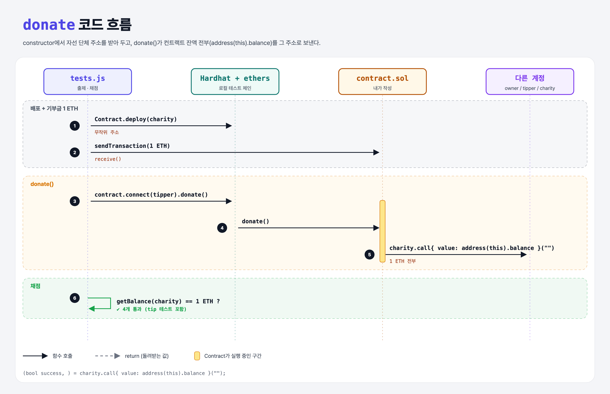

# Charity (Sending Ether 4단계)

## 문제

1. constructor가 **자선 단체 주소**를 인자로 받아 저장하게 바꾸기.
2. `donate()`를 만들어, 호출되면 컨트랙트에 남은 이더를 **전부** 자선 단체로 보내기.

## 한 줄 요약

`charity.call{ value: address(this).balance }("")` — `address(this).balance`가 컨트랙트의 현재 잔액이다.



---

## 0. 이 과제가 말하려는 것

```
… → transfer-tips → [기부하기] → selfdestruct
                     ★ 이 단계
```

- `this` = 이 컨트랙트. `address(this)`로 주소로 바꾸고, `.balance`로 잔액을 읽는다.

---

## 1. 파일 구성

| 파일 | 역할 |
|------|------|
| `contract.sol` | transfer-tips + **charity, donate** |
| `tests.js` | 출제 · 채점 (테스트 4개) |

---

## 2. 정답 코드

```solidity
address public charity;

constructor(address _charity) {
    owner = msg.sender;
    charity = _charity;
}

function donate() public {
    (bool success, ) = charity.call{ value: address(this).balance }("");
    require(success, "Donation failed");
}
```

---

## 3. tests.js 한 줄씩

```js
const charity = ethers.Wallet.createRandom().address;   // 잔액 0인 무작위 주소
contract = await Contract.deploy(charity);
await owner.sendTransaction({ to: contract.address, value: donation });   // 1 ETH 기부금
// tip 두 번 (0.25 × 2) → owner에게 바로 전달되므로 컨트랙트 잔액은 그대로 1 ETH
await contract.connect(tipper).donate();
assert.equal((await ethers.provider.getBalance(charity)).toString(), donation.toString());
```

---

## 5. 실행 방법

```bash
sh tools/sol-test.sh week4/charity
```

## 로컬 실행 환경 메모

강의 사이트는 브라우저 안에서 Hardhat으로 컴파일·테스트한다. 로컬에서도 똑같이 하려고 루트에 Hardhat(`hardhat@2.22`, `@nomiclabs/hardhat-ethers@2` = ethers v5)을 설치하고 `hardhat.config.js`를 만들었다. `STAGE` 환경 변수로 단계 폴더를 골라 그 폴더의 `.sol`만 컴파일한다. 테스트 파일의 전역 `ethers`는 Hardhat이 넣어 준다.

## 기억할 것

1. 컨트랙트 잔액 = `address(this).balance`.
2. constructor 인자로 설정값(주소 등)을 받는다.
