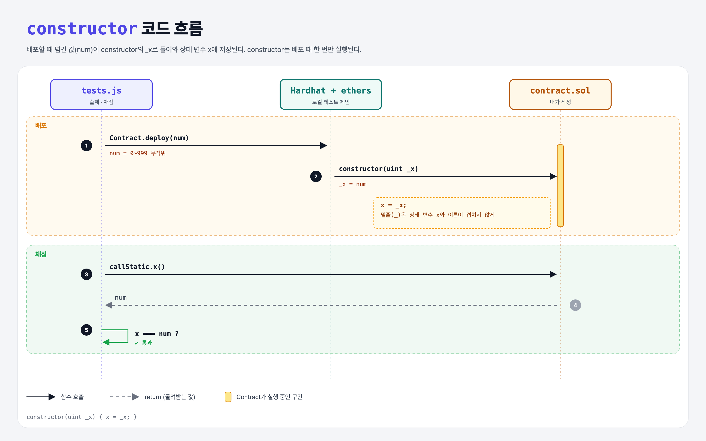

# Arguments (Functions 1단계)

## 문제

`uint`를 인자로 받는 **constructor**를 만들고, 그 값을 public 상태 변수 `x`에 저장하기.

## 한 줄 요약

`constructor(uint _x) { x = _x; }` — 배포하는 사람이 초기값을 정할 수 있다.



---

## 0. 이 과제가 말하려는 것

> **constructor는 배포할 때 딱 한 번 실행되는 초기화 함수다. 이후에는 다시 부를 수 없다.**

```
[constructor 인자] → increment → view → pure → 오버로딩
 ★ 이 단계          increment  view-addition  pure-double  overload-double
```

- Python의 `__init__`과 비슷하지만, **컨트랙트 수명 전체에서 한 번**뿐이다.
- 매개변수 이름 앞의 `_`는 상태 변수 `x`와 이름이 겹치는 것(**shadowing**)을 피하려는 관례다. Solidity는 `this.x` 없이 바로 `x`로 상태 변수를 쓰기 때문에 같은 이름이면 헷갈린다.

---

## 1. 파일 구성

| 파일 | 역할 |
|------|------|
| `contract.sol` | **이번에 완성할 컨트랙트** |
| `tests.js` | 출제 · 채점 (테스트 1개) |

---

## 2. 정답 코드

```solidity
contract Contract {
    uint public x;

    constructor(uint _x) {
        x = _x;
    }
}
```

```python
class Contract:
    def __init__(self, _x):
        self.x = _x
```

---

## 3. tests.js 한 줄씩

```js
const num = Math.floor(Math.random() * 1000);   // 0~999 무작위
contract = await Contract.deploy(num);          // deploy의 인자 = constructor 인자
const x = await contract.callStatic.x();
assert.equal(x, num);
```

---

## 4. 일부러 틀려 보면

| 바꾼 것 | 결과 |
|---------|------|
| `constructor(uint x) { x = x; }` | 매개변수 x가 상태 변수 x를 가려서 **자기 자신에 대입** → 상태 변수는 0 그대로 → 실패 (컴파일러가 shadowing 경고) |

---

## 5. 실행 방법

```bash
sh tools/sol-test.sh week4/constructor-arguments
```

## 로컬 실행 환경 메모

강의 사이트는 브라우저 안에서 Hardhat으로 컴파일·테스트한다. 로컬에서도 똑같이 하려고 루트에 Hardhat(`hardhat@2.22`, `@nomiclabs/hardhat-ethers@2` = ethers v5)을 설치하고 `hardhat.config.js`를 만들었다. `STAGE` 환경 변수로 단계 폴더를 골라 그 폴더의 `.sol`만 컴파일한다. 테스트 파일의 전역 `ethers`는 Hardhat이 넣어 준다.

## 기억할 것

1. constructor = 배포 때 한 번.
2. 매개변수 이름은 `_x`처럼 상태 변수와 다르게.
