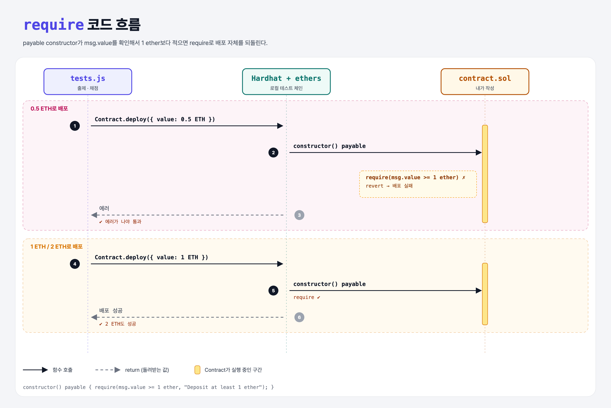

# Constructor Revert (Learning Revert 1단계)

## 문제

**payable constructor**를 만들고, 배포할 때 1 ether 이상을 보내지 않으면 거래를 되돌리기(revert).

## 한 줄 요약

`require(msg.value >= 1 ether, "...");` — 조건이 거짓이면 배포 자체가 없던 일이 된다.



---

## 0. 이 과제가 말하려는 것

> **revert = 거래를 처음부터 없던 것처럼 되돌리기. 상태 변화는 모두 취소되지만, 그때까지 쓴 가스는 낸다.**

```
[constructor에서 revert] → owner만 출금 → modifier
 ★ 이 단계                 owner-withdrawal  only-owner-modifier
```

| 방법 | 모양 |
|------|------|
| `require(조건)` / `require(조건, "메시지")` | 조건이 거짓이면 revert |
| `if (!조건) revert("메시지");` | 직접 확인 후 revert |
| `if (!조건) revert MyError(a, b);` | **사용자 정의 에러** (가스가 더 적음) |
| `assert(조건)` | "절대 일어나면 안 되는" 내부 오류 확인용 |

- `1 ether` = 10¹⁸ wei. `gwei`, `wei` 같은 단위도 숫자 뒤에 바로 쓸 수 있다.
- 실제 예: Uniswap 거래가 서명할 때와 블록에 들어갈 때 가격이 달라지면 `INSUFFICIENT_OUTPUT_AMOUNT`로 revert되고, 가스비만 나간다.

---

## 1. 파일 구성

| 파일 | 역할 |
|------|------|
| `contract.sol` | **이번에 완성할 컨트랙트** |
| `tests.js` | 출제 · 채점 (테스트 3개) |

---

## 2. 정답 코드

```solidity
contract Contract {
    constructor() payable {
        require(msg.value >= 1 ether, "Deposit at least 1 ether");
    }
}
```

Python이라면 `if not cond: raise Exception(...)`이지만, revert는 **그 거래가 바꾼 모든 상태까지** 되돌린다는 점이 다르다.

---

## 3. tests.js 한 줄씩

```js
try {
    const contract = await Contract.deploy({ value: ethers.utils.parseEther(".5") });
    await contract.deployed();
} catch (_ex) { ex = _ex; }
if (!ex) assert.fail("Contract was created with a .5 ether deposit");   // 에러가 나야 통과

await Contract.deploy({ value: ethers.utils.parseEther("1") });          // 1, 2 ETH는 성공해야 함
```

---

## 4. 일부러 틀려 보면

| 바꾼 것 | 결과 |
|---------|------|
| `>` (초과) | 정확히 1 ETH도 거부 → 두 번째 테스트 실패 |
| `payable` 빼먹음 | 이더를 보내는 배포가 전부 실패 |

---

## 5. 실행 방법

```bash
sh tools/sol-test.sh week4/constructor-revert
```

## 로컬 실행 환경 메모

강의 사이트는 브라우저 안에서 Hardhat으로 컴파일·테스트한다. 로컬에서도 똑같이 하려고 루트에 Hardhat(`hardhat@2.22`, `@nomiclabs/hardhat-ethers@2` = ethers v5)을 설치하고 `hardhat.config.js`를 만들었다. `STAGE` 환경 변수로 단계 폴더를 골라 그 폴더의 `.sol`만 컴파일한다. 테스트 파일의 전역 `ethers`는 Hardhat이 넣어 준다.

## 기억할 것

1. `require(조건, "메시지")` = 조건이 거짓이면 전부 되돌림.
2. 되돌려도 가스는 낸다.
3. 단위: `1 ether`, `1 gwei`.
