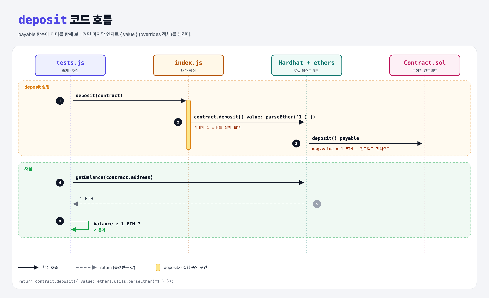

# Value Transfer (Contracts with ethers.js 5단계)

## 문제

`deposit(contract)`: 컨트랙트의 `deposit()`을 호출하면서 **1 ETH 이상**을 함께 보내기.

## 한 줄 요약

`contract.deposit({ value: ethers.utils.parseEther("1") })` — 보낼 이더는 마지막 인자인 **overrides 객체**에 넣는다.



---

## 0. 이 과제가 말하려는 것

> **함수 호출과 송금을 한 거래로 할 수 있다. 받는 함수는 `payable`이어야 한다.**

```
… → contract-signer → [이더 함께 보내기]
                       ★ 이 단계
```

overrides 객체에 넣을 수 있는 것: `value`, `gasLimit`, `gasPrice`, `nonce`, `chainId`. 항상 **함수 인자들 뒤 맨 마지막**에 넣는다.

```js
await contract.donate(charityId, { value: ethers.utils.parseEther("5") });   // 인자 1개 + overrides
```

---

## 1. 파일 구성

| 파일 | 역할 |
|------|------|
| `index.js` | **이번에 완성할 함수** |
| `Contract.sol` | `function deposit() payable external { }` |
| `tests.js` | 출제 · 채점 (테스트 1개) |

---

## 2. 정답 코드

```js
function deposit(contract) {
    return contract.deposit({ value: ethers.utils.parseEther("1") });
}
```

- 함수 몸체가 비어 있어도 `payable`이면 받은 이더가 컨트랙트 잔액으로 쌓인다.

---

## 3. tests.js 한 줄씩

```js
await deposit(contract);
const balance = await ethers.provider.getBalance(contract.address);   // 컨트랙트 주소의 ETH 잔액
assert(balance.gte(ethers.utils.parseEther("1")));
```

---

## 4. 일부러 틀려 보면

| 바꾼 것 | 결과 |
|---------|------|
| `{ value: 1 }` | 1 wei만 보냄 → 실패 |
| Solidity에서 `payable`을 뺌 | 이더를 보내면 revert (non-payable 함수) |

---

## 5. 실행 방법

```bash
sh tools/sol-test.sh week4/contract-deposit
```

## 로컬 실행 환경 메모

강의 사이트는 브라우저 안에서 Hardhat으로 컴파일·테스트한다. 로컬에서도 똑같이 하려고 루트에 Hardhat(`hardhat@2.22`, `@nomiclabs/hardhat-ethers@2` = ethers v5)을 설치하고 `hardhat.config.js`를 만들었다. `STAGE` 환경 변수로 단계 폴더를 골라 그 폴더의 `.sol`만 컴파일한다. 테스트 파일의 전역 `ethers`는 Hardhat이 넣어 준다.

이 문제들은 `pragma solidity 0.7.5;`라서 `hardhat.config.js`에 0.7.5 컴파일러도 넣어 두었다.

## 기억할 것

1. 이더는 overrides `{ value }`로, 맨 마지막 인자에.
2. 받는 함수는 `payable`.
