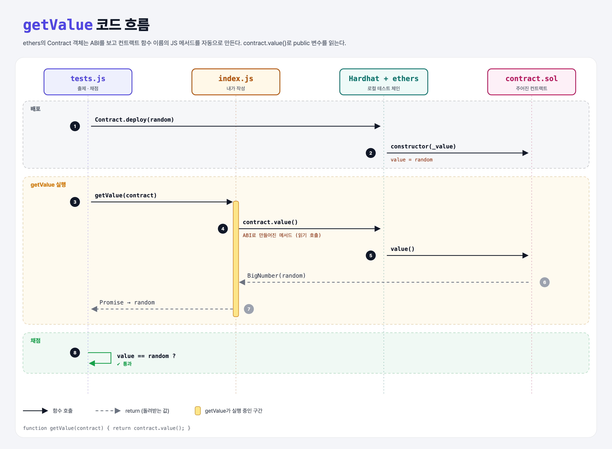

# Contracts (Contracts with ethers.js 1단계)

## 문제

`getValue(contract)`: ethers.js 컨트랙트 객체로 public 상태 변수 `value`를 읽어 돌려주기.

## 한 줄 요약

`return contract.value();` — ethers는 ABI를 보고 컨트랙트 함수와 같은 이름의 메서드를 자동으로 만든다.



---

## 0. 이 과제가 말하려는 것

> **JS에서 컨트랙트를 부르려면 주소 + ABI만 있으면 된다. ethers의 Contract 객체가 ABI를 읽어 함수를 만들어 준다.**

```
[값 읽기] → 값 바꾸기(거래) → 인자 여러 개
 ★ 이 단계  contract-set-value  contract-transfer
```

- **ABI**(Application Binary Interface): 컨트랙트에 어떤 함수가 있고, 인자·반환 타입이 무엇인지 적은 JSON. 컴파일하면 바이트코드와 함께 나온다.
- 바이트코드는 체인에 올리고, ABI는 프론트엔드가 들고 있는다.

---

## 1. 파일 구성

| 파일 | 역할 |
|------|------|
| `index.js` | **이번에 완성할 함수** |
| `contract.sol` | 주어진 컨트랙트 (`uint public value`) |
| `tests.js` | 출제 · 채점 (테스트 1개) |

---

## 2. 정답 코드

```js
function getValue(contract) {
    return contract.value();
}
```

- Promise를 그대로 돌려줘도 되고, `async function getValue(contract) { return await contract.value(); }`로 써도 결과는 같다.

---

## 3. tests.js 한 줄씩

```js
const random = Math.floor(Math.random() * 1000);
contract = await Contract.deploy(random);     // constructor(uint _value)
const value = await getValue(contract);
assert.equal(value, random);                  // BigNumber == 숫자 (느슨한 비교)
```

---

## 5. 실행 방법

```bash
sh tools/sol-test.sh week4/contract-get-value
```

## 로컬 실행 환경 메모

강의 사이트는 브라우저 안에서 Hardhat으로 컴파일·테스트한다. 로컬에서도 똑같이 하려고 루트에 Hardhat(`hardhat@2.22`, `@nomiclabs/hardhat-ethers@2` = ethers v5)을 설치하고 `hardhat.config.js`를 만들었다. `STAGE` 환경 변수로 단계 폴더를 골라 그 폴더의 `.sol`만 컴파일한다. 테스트 파일의 전역 `ethers`는 Hardhat이 넣어 준다.

이 문제들은 `pragma solidity 0.7.5;`라서 `hardhat.config.js`에 0.7.5 컴파일러도 넣어 두었다.

## 기억할 것

1. 컨트랙트 호출 = 주소 + ABI.
2. ethers Contract는 ABI의 함수를 메서드로 만들어 준다.
