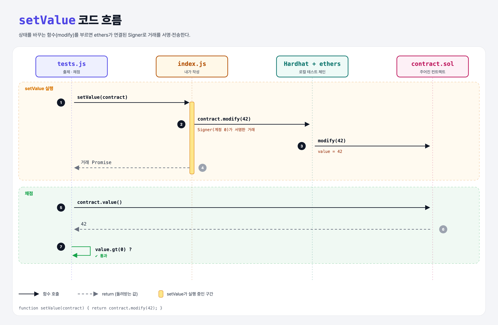

# Transactions (Contracts with ethers.js 2단계)

## 문제

`setValue(contract)`: 컨트랙트의 `modify()`를 불러 `value`를 0이 아닌 값으로 바꾸기.

## 한 줄 요약

`return contract.modify(42);` — 상태를 바꾸는 함수는 ethers가 자동으로 **서명해서 거래로** 보낸다.



---

## 0. 이 과제가 말하려는 것

> **읽기(call)와 쓰기(거래)는 JS 코드 모양이 같다. 차이는 ethers가 알아서 처리한다: 컨트랙트에 연결된 Signer(계정)가 거래에 서명한다.**

```
contract-get-value → [값 바꾸기(거래)] → 인자 여러 개
                      ★ 이 단계
```

- **Signer**: 거래에 서명할 수 있는 계정(EOA). 3주차의 Wallet도 Signer의 한 종류다.
- Hardhat 테스트에서 `getContractFactory`로 배포한 컨트랙트는 기본 계정(계정 0)이 Signer로 연결되어 있다.

---

## 1. 파일 구성

| 파일 | 역할 |
|------|------|
| `index.js` | **이번에 완성할 함수** |
| `contract.sol` | 주어진 컨트랙트 (`modify(uint)`) |
| `tests.js` | 출제 · 채점 (테스트 1개) |

---

## 2. 정답 코드

```js
function setValue(contract) {
    return contract.modify(42);
}
```

- 반환값은 결과값이 아니라 **거래 객체의 Promise**다. 거래 결과로 값을 돌려받을 수는 없다.

---

## 3. tests.js 한 줄씩

```js
await setValue(contract);
const value = await contract.value();
assert(value.gt(0), "Expecting value to be modified. Still set at 0!");
```

---

## 5. 실행 방법

```bash
sh tools/sol-test.sh week4/contract-set-value
```

## 로컬 실행 환경 메모

강의 사이트는 브라우저 안에서 Hardhat으로 컴파일·테스트한다. 로컬에서도 똑같이 하려고 루트에 Hardhat(`hardhat@2.22`, `@nomiclabs/hardhat-ethers@2` = ethers v5)을 설치하고 `hardhat.config.js`를 만들었다. `STAGE` 환경 변수로 단계 폴더를 골라 그 폴더의 `.sol`만 컴파일한다. 테스트 파일의 전역 `ethers`는 Hardhat이 넣어 준다.

이 문제들은 `pragma solidity 0.7.5;`라서 `hardhat.config.js`에 0.7.5 컴파일러도 넣어 두었다.

## 기억할 것

1. 쓰기 함수 호출 = 거래 (Signer가 서명).
2. 거래의 반환값은 거래 객체 (함수 결과 X).
