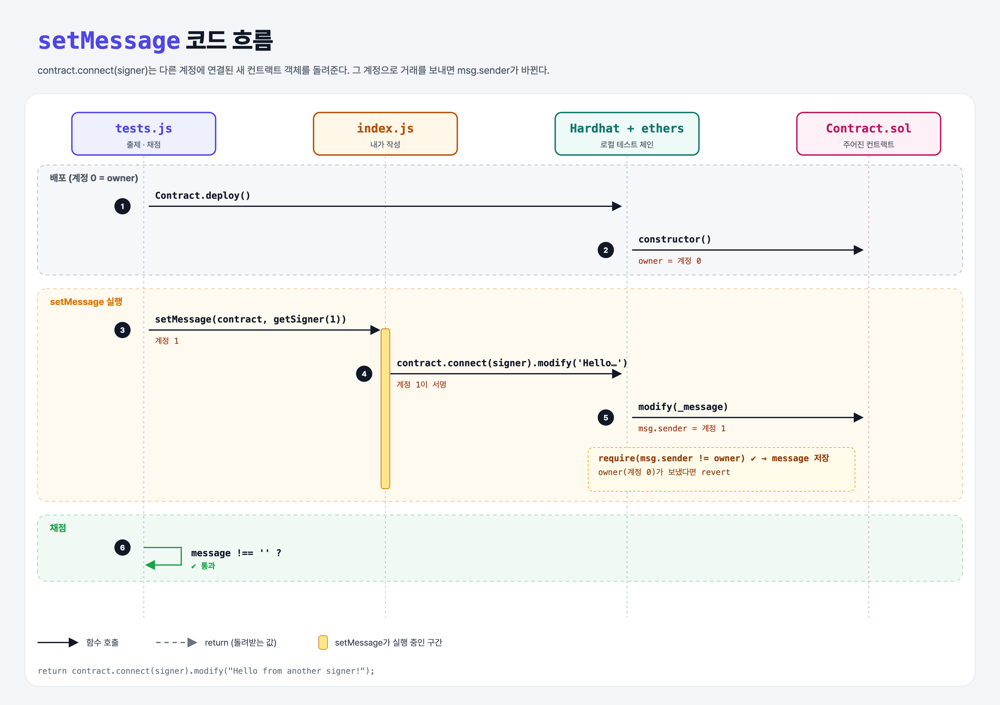

# Signer (Contracts with ethers.js 4단계)

## 문제

`setMessage(contract, signer)`: 컨트랙트의 `message`를 빈 문자열이 아닌 값으로 바꾸기. 단, **owner(배포자)는 바꿀 수 없어서** 넘겨받은 다른 signer로 연결해서 호출해야 한다.

## 한 줄 요약

`contract.connect(signer).modify("…")` — `connect`로 다른 계정에 연결한 컨트랙트 객체를 만들어 거래를 보낸다.



---

## 0. 이 과제가 말하려는 것

> **같은 컨트랙트라도 누가 거래를 보내느냐(msg.sender)에 따라 결과가 달라진다. 테스트에서 여러 사용자를 흉내 낼 때 connect를 쓴다.**

```
… → contract-transfer → [다른 Signer로 호출] → 이더 보내기
                         ★ 이 단계
```

- `connect`는 원래 객체를 바꾸지 않고 **새 객체**를 돌려준다. 그래서 `contract.connect(s).함수()`처럼 이어 쓴다.

---

## 1. 파일 구성

| 파일 | 역할 |
|------|------|
| `index.js` | **이번에 완성할 함수** |
| `Contract.sol` | 주어진 컨트랙트 (owner는 수정 금지) |
| `tests.js` | 출제 · 채점 (테스트 1개) |

```solidity
function modify(string calldata _message) external {
    require(msg.sender != owner, "Owner cannot modify the message!");
    message = _message;
}
```

- `calldata`: 외부에서 받은 인자를 복사하지 않고 읽기 전용으로 쓰는 위치 (가스 절약).

---

## 2. 정답 코드

```js
function setMessage(contract, signer) {
    return contract.connect(signer).modify("Hello from another signer!");
}
```

---

## 3. tests.js 한 줄씩

```js
await setMessage(contract, ethers.provider.getSigner(1));   // 계정 1
assert.notEqual(await contract.message(), "", "...");
```

---

## 4. 일부러 틀려 보면

| 바꾼 것 | 결과 |
|---------|------|
| `contract.modify("…")` (connect 없이) | 계정 0(owner)이 보내서 `Owner cannot modify the message!` revert |

---

## 5. 실행 방법

```bash
sh tools/sol-test.sh week4/contract-signer
```

## 로컬 실행 환경 메모

강의 사이트는 브라우저 안에서 Hardhat으로 컴파일·테스트한다. 로컬에서도 똑같이 하려고 루트에 Hardhat(`hardhat@2.22`, `@nomiclabs/hardhat-ethers@2` = ethers v5)을 설치하고 `hardhat.config.js`를 만들었다. `STAGE` 환경 변수로 단계 폴더를 골라 그 폴더의 `.sol`만 컴파일한다. 테스트 파일의 전역 `ethers`는 Hardhat이 넣어 준다.

이 문제들은 `pragma solidity 0.7.5;`라서 `hardhat.config.js`에 0.7.5 컴파일러도 넣어 두었다.

## 기억할 것

1. `contract.connect(signer)` = 다른 계정으로 호출하는 새 객체.
2. 컨트랙트 안의 `msg.sender`가 그 계정이 된다.
