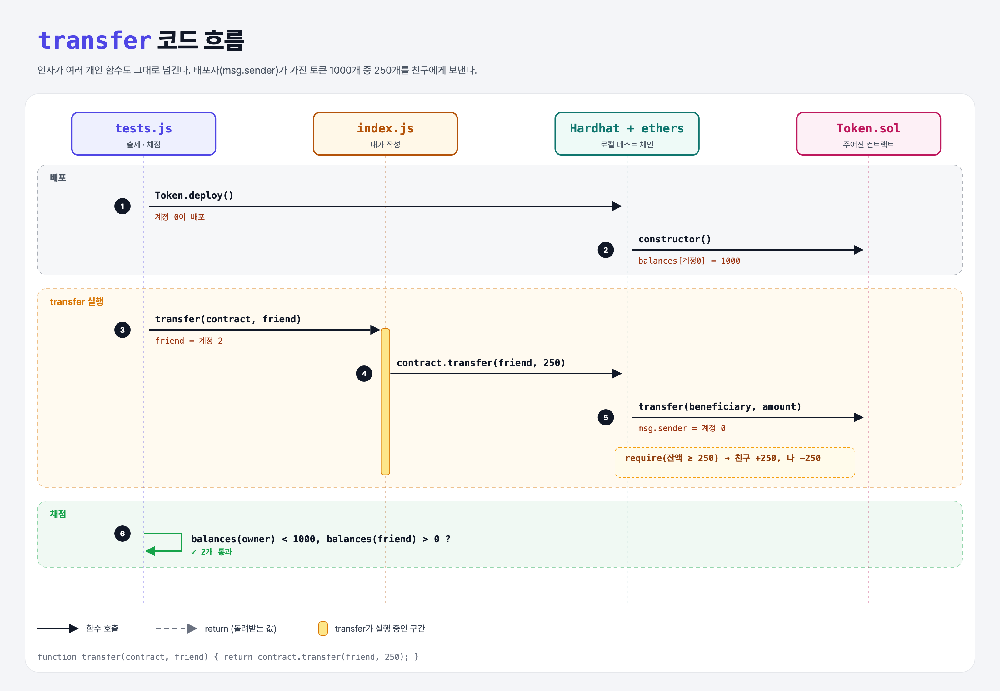

# Multiple Arguments (Contracts with ethers.js 3단계)

## 문제

`transfer(contract, friend)`: 토큰 컨트랙트에서 내(Signer) 잔액 일부를 `friend` 주소로 보내기. 배포자는 처음에 1000을 가진다.

## 한 줄 요약

`return contract.transfer(friend, 250);` — 인자가 여러 개면 순서대로 넘기면 된다.



---

## 0. 이 과제가 말하려는 것

> **간단한 토큰 = 주소별 잔액을 적은 장부(mapping). 이더리움 위의 토큰은 대부분 이 구조다 (6주차 ERC-20).**

```
contract-get-value → contract-set-value → [인자 여러 개]
                                           ★ 이 단계
```

주어진 Token.sol:

```solidity
mapping(address => uint) public balances;        // 주소 → 잔액 (Python dict)

constructor() { balances[msg.sender] = 1000; }   // msg.sender = 이 거래를 보낸 사람

function transfer(address beneficiary, uint amount) external {
    require(balances[msg.sender] >= amount, "Balance too low!");   // 조건이 거짓이면 되돌림(revert)
    balances[beneficiary] += amount;
    balances[msg.sender] -= amount;
}
```

---

## 1. 파일 구성

| 파일 | 역할 |
|------|------|
| `index.js` | **이번에 완성할 함수** |
| `Token.sol` | 주어진 토큰 컨트랙트 |
| `tests.js` | 출제 · 채점 (테스트 2개) |

---

## 2. 정답 코드

```js
function transfer(contract, friend) {
    return contract.transfer(friend, 250);
}
```

---

## 3. tests.js 한 줄씩

```js
const accounts = await ethers.provider.listAccounts();   // Hardhat 테스트 계정 20개
owner = accounts[1];
friend = accounts[2];
await transfer(contract, friend);
assert((await contract.balances(owner)).lt(1000));
assert((await contract.balances(friend)).gt(0));
```

- 테스트는 `owner`를 `accounts[1]`로 잡지만, 실제 배포자(Signer)는 `accounts[0]`이다. `accounts[1]`의 잔액은 원래 0이라 "1000보다 작다"는 항상 참이다. 테스트의 작은 실수로 보인다.
- `balances(owner)`처럼 public mapping도 getter가 생긴다 (키를 인자로 받음).

---

## 4. 일부러 틀려 보면

| 바꾼 것 | 결과 |
|---------|------|
| `contract.transfer(friend, 2000)` | `require` 실패 → `Balance too low!`로 revert |

---

## 5. 실행 방법

```bash
sh tools/sol-test.sh week4/contract-transfer
```

## 로컬 실행 환경 메모

강의 사이트는 브라우저 안에서 Hardhat으로 컴파일·테스트한다. 로컬에서도 똑같이 하려고 루트에 Hardhat(`hardhat@2.22`, `@nomiclabs/hardhat-ethers@2` = ethers v5)을 설치하고 `hardhat.config.js`를 만들었다. `STAGE` 환경 변수로 단계 폴더를 골라 그 폴더의 `.sol`만 컴파일한다. 테스트 파일의 전역 `ethers`는 Hardhat이 넣어 준다.

이 문제들은 `pragma solidity 0.7.5;`라서 `hardhat.config.js`에 0.7.5 컴파일러도 넣어 두었다.

## 기억할 것

1. 인자는 Solidity 함수 순서대로.
2. `msg.sender` = 거래를 보낸 계정.
3. `require(조건, 메시지)` = 조건이 거짓이면 전체를 되돌림.
