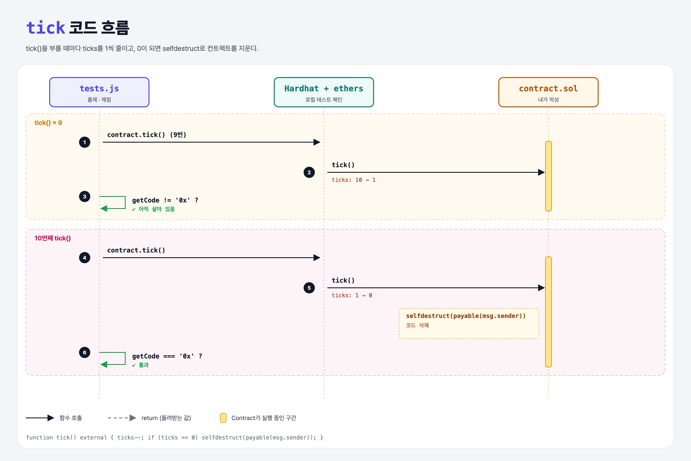

# Countdown

## 문제

external 함수 `tick`을 만들어서, **10번** 호출되면 컨트랙트가 selfdestruct 되게 하기.

## 한 줄 요약

카운터를 10에서 시작해 `tick`마다 줄이고, 0이 되면 `selfdestruct`.



---

## 0. 이 과제가 말하려는 것

> **Practice Solidity 두 번째 문제. 상태 변수로 횟수를 세고, 조건에 따라 selfdestruct (self-destruct 과제 복습).**

---

## 1. 파일 구성

| 파일 | 역할 |
|------|------|
| `contract.sol` | **이번에 완성할 컨트랙트** |
| `tests.js` | 출제 · 채점 (테스트 2개) |

---

## 2. 정답 코드

```solidity
uint ticks = 10;

function tick() external {
    ticks--;
    if (ticks == 0) {
        selfdestruct(payable(msg.sender));
    }
}
```

- 강의 예시와 같은 구조다. selfdestruct의 받는 주소는 마지막으로 tick을 부른 사람.

---

## 3. tests.js 한 줄씩

```js
for (let i = 0; i < 9; i++) await contract.tick();
assert(await ethers.provider.getCode(contract.address) !== "0x");   // 9번까지는 살아 있음
await contract.tick();
assert.equal(await ethers.provider.getCode(contract.address), "0x"); // 10번째에 사라짐
```

---

## 4. 일부러 틀려 보면

| 바꾼 것 | 결과 |
|---------|------|
| `ticks = 9`로 시작 | 9번째에 사라져서 첫 테스트 실패 |
| 0이 된 뒤 또 tick | 0 − 1은 uint underflow → 0.8부터 자동 revert (그 전에 사라지긴 함) |

---

## 5. 실행 방법

```bash
sh tools/sol-test.sh week4/countdown
```

## 로컬 실행 환경 메모

강의 사이트는 브라우저 안에서 Hardhat으로 컴파일·테스트한다. 로컬에서도 똑같이 하려고 루트에 Hardhat(`hardhat@2.22`, `@nomiclabs/hardhat-ethers@2` = ethers v5)을 설치하고 `hardhat.config.js`를 만들었다. `STAGE` 환경 변수로 단계 폴더를 골라 그 폴더의 `.sol`만 컴파일한다. 테스트 파일의 전역 `ethers`는 Hardhat이 넣어 준다.

selfdestruct가 코드를 지우려면 Cancun 이전 규칙이 필요해서 `hardhat.config.js`에서 `hardfork: "shanghai"`로 설정했다 (self-destruct 과제 참고).

## 기억할 것

1. 상태 변수로 횟수 세기.
2. selfdestruct는 비권장 기능 (연습용).
