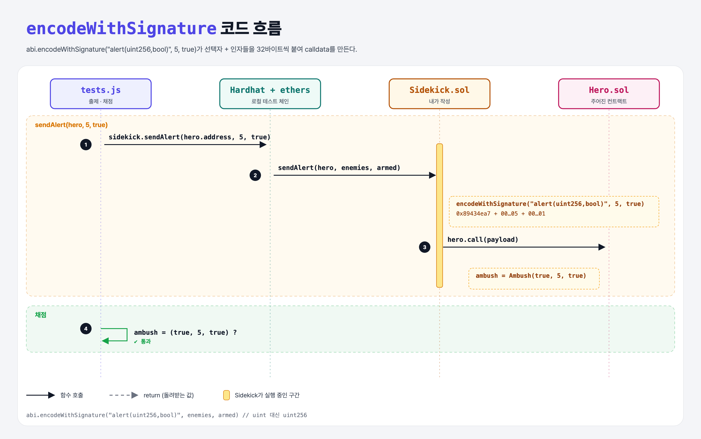

# With Signature (Sending Data 3단계)

## 문제

`abi.encodeWithSignature`로 Hero의 `alert(uint, bool)`을 **인자와 함께** 호출하기 (적의 수, 무장 여부).

## 한 줄 요약

`abi.encodeWithSignature("alert(uint256,bool)", enemies, armed)` — 선택자 계산 + 인자 인코딩을 한 번에.



---

## 0. 이 과제가 말하려는 것

```
… → function-signature → [encodeWithSignature] → calldata 전달 → fallback
                          ★ 이 단계
```

`alert(5, true)`의 calldata:

```
0x89434ea7                                                          ← 선택자 keccak256("alert(uint256,bool)")[:4]
0000000000000000000000000000000000000000000000000000000000000005    ← enemies = 5 (32바이트)
0000000000000000000000000000000000000000000000000000000000000001    ← armed = true (32바이트)
```

⚠️ 시그니처에는 `uint`가 아니라 **`uint256`**을 써야 한다. `alert(uint,bool)`의 선택자는 `0xb5144213`으로 완전히 다르다 (직접 계산해 확인함).

---

## 1. 파일 구성

| 파일 | 역할 |
|------|------|
| `Sidekick.sol` | **calldata 채우기** |
| `Hero.sol` | `alert(uint enemies, bool armed)` → `ambush` struct 저장 |
| `tests.js` | 출제 · 채점 (테스트 1개) |

Hero의 `struct Ambush { bool alerted; uint enemies; bool armed; }`는 여러 값을 묶은 사용자 정의 타입 (Python dataclass와 비슷).

---

## 2. 정답 코드

```solidity
function sendAlert(address hero, uint enemies, bool armed) external {
    (bool success, ) = hero.call(
        abi.encodeWithSignature("alert(uint256,bool)", enemies, armed)
    );

    require(success);
}
```

---

## 3. tests.js 한 줄씩

```js
await sidekick.sendAlert(hero.address, 5, true);
const ambush = await hero.ambush();          // public struct getter → [alerted, enemies, armed]
assert(ambush.alerted);
assert.equal(ambush.enemies, 5);
assert.equal(ambush.armed, true);
```

---

## 5. 실행 방법

```bash
sh tools/sol-test.sh week4/encode-with-signature
```

## 로컬 실행 환경 메모

강의 사이트는 브라우저 안에서 Hardhat으로 컴파일·테스트한다. 로컬에서도 똑같이 하려고 루트에 Hardhat(`hardhat@2.22`, `@nomiclabs/hardhat-ethers@2` = ethers v5)을 설치하고 `hardhat.config.js`를 만들었다. `STAGE` 환경 변수로 단계 폴더를 골라 그 폴더의 `.sol`만 컴파일한다. 테스트 파일의 전역 `ethers`는 Hardhat이 넣어 준다.

## 기억할 것

1. calldata = 선택자 4바이트 + 인자들(각 32바이트).
2. 시그니처엔 정식 타입 이름(`uint256`).
