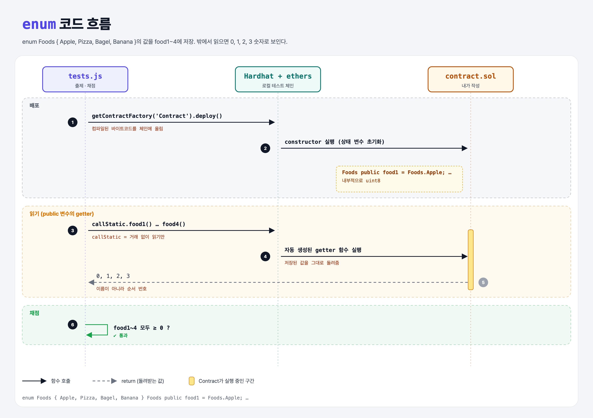

# Enum Type (Data Types 5단계)

## 문제

주어진 `enum Foods { Apple, Pizza, Bagel, Banana }`의 값을 `food1` ~ `food4`에 저장하기.

## 한 줄 요약

enum = **이름 붙은 선택지 목록**. 내부적으로는 0, 1, 2, 3 숫자로 저장된다.



---

## 0. 이 과제가 말하려는 것

> **`movement == 0` 같은 마법의 숫자 대신 `Directions.Up`처럼 이름으로 쓰면 읽기 쉽고 실수가 줄어든다.**

```
… → string-literals → [enum]
                       ★ 이 단계
```

- 값이 256개 미만이면 `uint8`로 저장된다.
- 밖(JS)에서 읽으면 이름이 아니라 **숫자**가 온다. ABI에는 uint8로 표시된다.
- Python의 `enum.Enum`과 비슷하다.

---

## 1. 파일 구성

| 파일 | 역할 |
|------|------|
| `contract.sol` | **값을 채울 컨트랙트** |
| `tests.js` | 출제 · 채점 (테스트 1개) |

---

## 2. 정답 코드

```solidity
contract Contract {
    enum Foods { Apple, Pizza, Bagel, Banana }

    Foods public food1 = Foods.Apple;    // 0
    Foods public food2 = Foods.Pizza;    // 1
    Foods public food3 = Foods.Bagel;    // 2
    Foods public food4 = Foods.Banana;   // 3
}
```

---

## 3. tests.js 한 줄씩

```js
for (let i = 1; i <= 4; i++) {
    const food = await contract.callStatic[`food${i}`]();   // food1() … food4()를 이름으로 골라 호출
    assert.isAtLeast(food, 0);
}
```

- `contract.callStatic['food1']`처럼 대괄호로 함수 이름을 문자열로 골라 부를 수 있다 (Python `getattr(obj, "food1")`).

---

## 4. 일부러 틀려 보면

| 바꾼 것 | 결과 |
|---------|------|
| `Foods public food1 = 0;` | 컴파일 에러: 숫자를 enum에 바로 넣을 수 없음 (`Foods(0)`처럼 변환해야 함) |

---

## 5. 실행 방법

```bash
sh tools/sol-test.sh week4/enum-type
```

## 로컬 실행 환경 메모

강의 사이트는 브라우저 안에서 Hardhat으로 컴파일·테스트한다. 로컬에서도 똑같이 하려고 루트에 Hardhat(`hardhat@2.22`, `@nomiclabs/hardhat-ethers@2` = ethers v5)을 설치하고 `hardhat.config.js`를 만들었다. `STAGE` 환경 변수로 단계 폴더를 골라 그 폴더의 `.sol`만 컴파일한다. 테스트 파일의 전역 `ethers`는 Hardhat이 넣어 준다.

## 기억할 것

1. enum = 이름 붙은 선택지, 내부는 uint8.
2. 밖에서 읽으면 숫자.
