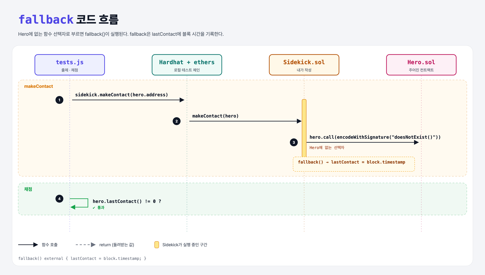

# Fallback (Sending Data 5단계)

## 문제

Sidekick의 `makeContact`에서 Hero의 **fallback 함수**가 실행되도록 calldata를 보내기.

## 한 줄 요약

Hero에 **없는 함수 선택자**로 부르면 `fallback()`이 실행된다.



---

## 0. 이 과제가 말하려는 것

```
… → pass-calldata → [fallback]
                     ★ 이 단계
```

| 들어온 calldata | 실행되는 함수 |
|-----------------|---------------|
| 앞 4바이트가 어떤 함수 선택자와 일치 | 그 함수 |
| 비어 있고 이더가 옴 | `receive()` (없으면 payable fallback) |
| 그 외 (일치하는 선택자 없음, 4바이트 미만 등) | `fallback()` |

---

## 1. 파일 구성

| 파일 | 역할 |
|------|------|
| `Sidekick.sol` | **makeContact 채우기** |
| `Hero.sol` | `fallback() external { lastContact = block.timestamp; }` |
| `tests.js` | 출제 · 채점 (테스트 1개) |

---

## 2. 정답 코드

```solidity
function makeContact(address hero) external {
    (bool success, ) = hero.call(abi.encodeWithSignature("doesNotExist()"));
    require(success);
}
```

- `hero.call("")`(빈 calldata)도 Hero에 receive가 없으니 fallback으로 간다.
- `block.timestamp`: 현재 블록의 시간(초). 0이 아니게 된다.

---

## 3. tests.js 한 줄씩

```js
await sidekick.makeContact(hero.address);
assert.notEqual((await hero.lastContact()).toNumber(), 0);
```

---

## 5. 실행 방법

```bash
sh tools/sol-test.sh week4/fallback
```

## 로컬 실행 환경 메모

강의 사이트는 브라우저 안에서 Hardhat으로 컴파일·테스트한다. 로컬에서도 똑같이 하려고 루트에 Hardhat(`hardhat@2.22`, `@nomiclabs/hardhat-ethers@2` = ethers v5)을 설치하고 `hardhat.config.js`를 만들었다. `STAGE` 환경 변수로 단계 폴더를 골라 그 폴더의 `.sol`만 컴파일한다. 테스트 파일의 전역 `ethers`는 Hardhat이 넣어 준다.

## 기억할 것

1. 맞는 함수가 없으면 `fallback()`.
2. 빈 calldata + 이더면 `receive()`.
