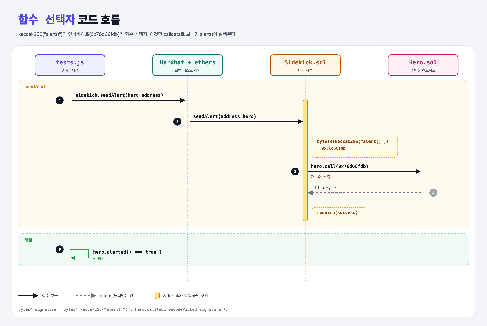

# Function Signature (Sending Data 2단계)

## 문제

calldata를 **직접** 만들어 Hero의 `alert()`를 부르기. 빈칸 `keccak256("")`에 알맞은 함수 시그니처를 채운다.

## 한 줄 요약

`bytes4(keccak256("alert()"))` = `0x76d66fdb` — 인자 없는 함수는 이 4바이트가 calldata의 전부다.



---

## 0. 이 과제가 말하려는 것

> **함수 선택자(selector) = keccak256(함수 시그니처)의 앞 4바이트. EVM은 calldata 맨 앞 4바이트로 어떤 함수를 실행할지 고른다.**

```
interface-alert → [함수 선택자 직접] → encodeWithSignature → calldata 전달 → fallback
                   ★ 이 단계
```

| 시그니처 | 선택자 |
|----------|--------|
| `alert()` | `0x76d66fdb` |
| `rumble()` | `0x7e47cd7e` (강의 예시) |

시그니처는 **이름 + 괄호 안 타입, 공백 없이** 쓴다.

---

## 1. 파일 구성

| 파일 | 역할 |
|------|------|
| `Sidekick.sol` | **시그니처 채우기** |
| `Hero.sol` | interface-alert와 같음 |
| `tests.js` | interface-alert와 같음 |

---

## 2. 정답 코드

```solidity
function sendAlert(address hero) external {
    bytes4 signature = bytes4(keccak256("alert()"));

    (bool success, ) = hero.call(abi.encodePacked(signature));

    require(success);
}
```

- `address.call(bytes)`: 저수준 호출. 받는 쪽 함수가 뭔지 컴파일러가 확인하지 않는다.

---

## 4. 일부러 틀려 보면

| 바꾼 것 | 결과 |
|---------|------|
| `keccak256("alert")` (괄호 없음) | 다른 선택자 → Hero에 없는 함수 → Hero에 fallback이 없어서 call 실패 → `require(success)` revert |
| `"alert ()"` (공백) | 마찬가지로 다른 선택자 |

---

## 5. 실행 방법

```bash
sh tools/sol-test.sh week4/function-signature
```

## 로컬 실행 환경 메모

강의 사이트는 브라우저 안에서 Hardhat으로 컴파일·테스트한다. 로컬에서도 똑같이 하려고 루트에 Hardhat(`hardhat@2.22`, `@nomiclabs/hardhat-ethers@2` = ethers v5)을 설치하고 `hardhat.config.js`를 만들었다. `STAGE` 환경 변수로 단계 폴더를 골라 그 폴더의 `.sol`만 컴파일한다. 테스트 파일의 전역 `ethers`는 Hardhat이 넣어 준다.

## 기억할 것

1. 선택자 = keccak256("이름(타입,...)")의 앞 4바이트.
2. 저수준 `call`은 성공 여부를 꼭 확인.
