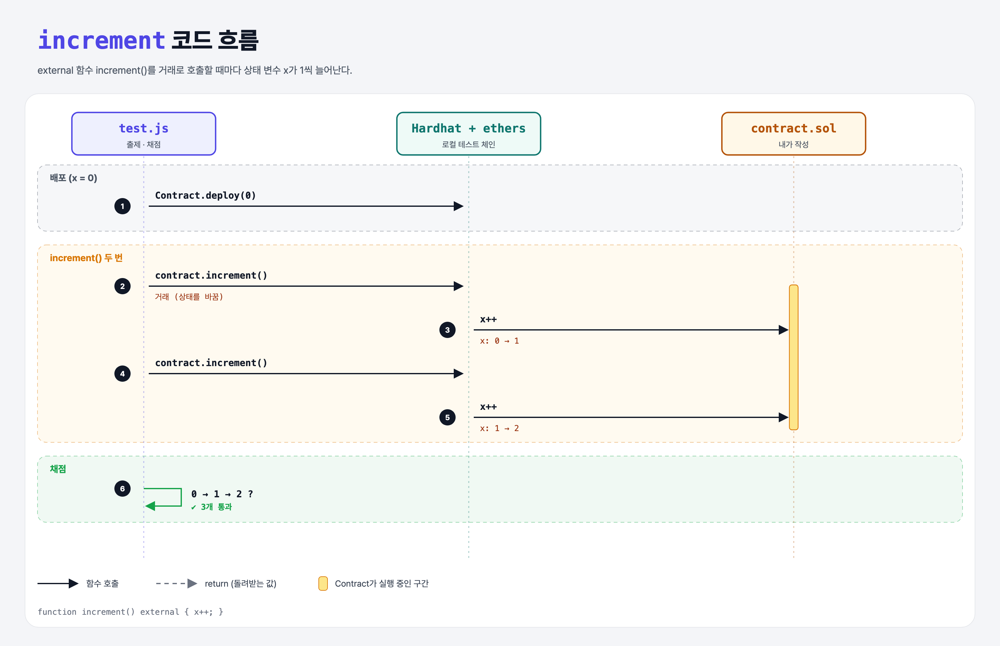

# Increment (Functions 2단계)

## 문제

`x`에 1을 더하는 **external** 함수 `increment` 만들기.

## 한 줄 요약

`function increment() external { x++; }` — 상태를 바꾸는 함수는 **거래**로 호출된다.



---

## 0. 이 과제가 말하려는 것

> **컨트랙트 함수는 두 가지로 불린다. 상태를 바꾸는 호출은 거래(가스 필요, 채굴 필요), 읽기만 하는 호출은 쿼리(무료, 즉시).**

```
constructor-arguments → [increment] → view → pure → 오버로딩
                         ★ 이 단계
```

| 공개 범위 | 밖에서 호출 | 안에서 호출 | 비고 |
|-----------|-------------|-------------|------|
| `external` | ✔ | ✘ | 밖에서만 부를 거면 가스가 조금 적다 |
| `public` | ✔ | ✔ | |
| `internal` | ✘ | ✔ (상속한 컨트랙트 포함) | |
| `private` | ✘ | ✔ (이 컨트랙트만) | |

---

## 1. 파일 구성

| 파일 | 역할 |
|------|------|
| `contract.sol` | 앞 단계 + **increment** |
| `test.js` | 출제 · 채점 (테스트 3개) |

---

## 2. 정답 코드

```solidity
function increment() external {
    x++;
}
```

- `x++`, `x += 1`, `x = x + 1` 모두 같다. JS의 축약 연산자(`-=`, `*=`, `--` …)를 그대로 쓸 수 있다.

---

## 3. test.js 한 줄씩

```js
contract = await Contract.deploy(0);
await contract.increment();              // 거래를 보냄 (callStatic이 아님)
const x = await contract.callStatic.x(); // 1
```

- `contract.increment()`는 거래를 보내고, `contract.callStatic.increment()`는 "실행하면 어떻게 될지"만 보고 상태는 안 바꾼다.

---

## 5. 실행 방법

```bash
sh tools/sol-test.sh week4/increment
```

## 로컬 실행 환경 메모

강의 사이트는 브라우저 안에서 Hardhat으로 컴파일·테스트한다. 로컬에서도 똑같이 하려고 루트에 Hardhat(`hardhat@2.22`, `@nomiclabs/hardhat-ethers@2` = ethers v5)을 설치하고 `hardhat.config.js`를 만들었다. `STAGE` 환경 변수로 단계 폴더를 골라 그 폴더의 `.sol`만 컴파일한다. 테스트 파일의 전역 `ethers`는 Hardhat이 넣어 준다.

## 기억할 것

1. 상태를 바꾸는 함수 = 거래.
2. `external`은 밖에서만, `public`은 안팎 모두.
