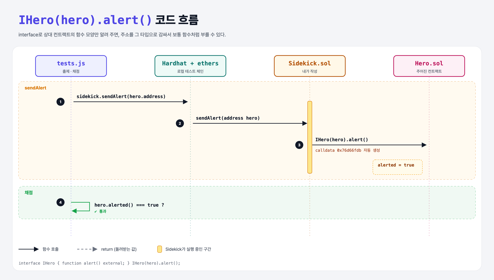

# Interfaces (Sending Data 1단계)

## 문제

`IHero` 인터페이스와 넘겨받은 `hero` 주소로, Sidekick 컨트랙트에서 Hero의 `alert()`를 호출하기.

## 한 줄 요약

`IHero(hero).alert();` — 주소를 인터페이스 타입으로 감싸면 상대 컨트랙트 함수를 그냥 부를 수 있다.



---

## 0. 이 과제가 말하려는 것

> **컨트랙트가 다른 컨트랙트를 부를 때도 calldata(함수 선택자 + 인자)를 보낸다. 인터페이스는 그 calldata를 Solidity가 대신 만들게 해 주는 "함수 모양 설명서"다.**

```
[interface] → 함수 선택자 직접 → encodeWithSignature → calldata 전달 → fallback
 ★ 이 단계    function-signature  encode-with-signature  pass-calldata  fallback
```

- 상대 컨트랙트의 전체 코드는 필요 없다. 부를 함수의 이름·인자·반환 타입만 적으면 된다.
- Python으로 치면 "이 객체에는 alert()라는 메서드가 있다"고 타입 힌트(Protocol)를 주는 것과 비슷하다.

---

## 1. 파일 구성

| 파일 | 역할 |
|------|------|
| `Sidekick.sol` | **이번에 완성할 컨트랙트** |
| `Hero.sol` | 주어진 컨트랙트 (`alert()` → `alerted = true`) |
| `tests.js` | 출제 · 채점 (테스트 1개) |

---

## 2. 정답 코드

```solidity
interface IHero {
    function alert() external;
}

contract Sidekick {
    function sendAlert(address hero) external {
        IHero(hero).alert();
    }
}
```

---

## 3. tests.js 한 줄씩

```js
sidekick = await Sidekick.deploy();
hero = await Hero.deploy();
await sidekick.sendAlert(hero.address);          // 컨트랙트 → 컨트랙트 호출
assert.equal(await hero.alerted.call(), true);
```

- 이 거래에서 Hero 입장의 `msg.sender`는 **Sidekick 컨트랙트 주소**다 (테스트 계정이 아님).

---

## 5. 실행 방법

```bash
sh tools/sol-test.sh week4/interface-alert
```

## 로컬 실행 환경 메모

강의 사이트는 브라우저 안에서 Hardhat으로 컴파일·테스트한다. 로컬에서도 똑같이 하려고 루트에 Hardhat(`hardhat@2.22`, `@nomiclabs/hardhat-ethers@2` = ethers v5)을 설치하고 `hardhat.config.js`를 만들었다. `STAGE` 환경 변수로 단계 폴더를 골라 그 폴더의 `.sol`만 컴파일한다. 테스트 파일의 전역 `ethers`는 Hardhat이 넣어 준다.

## 기억할 것

1. `Interface(주소).함수()` = 다른 컨트랙트 호출.
2. 인터페이스엔 함수 모양만 적는다.
