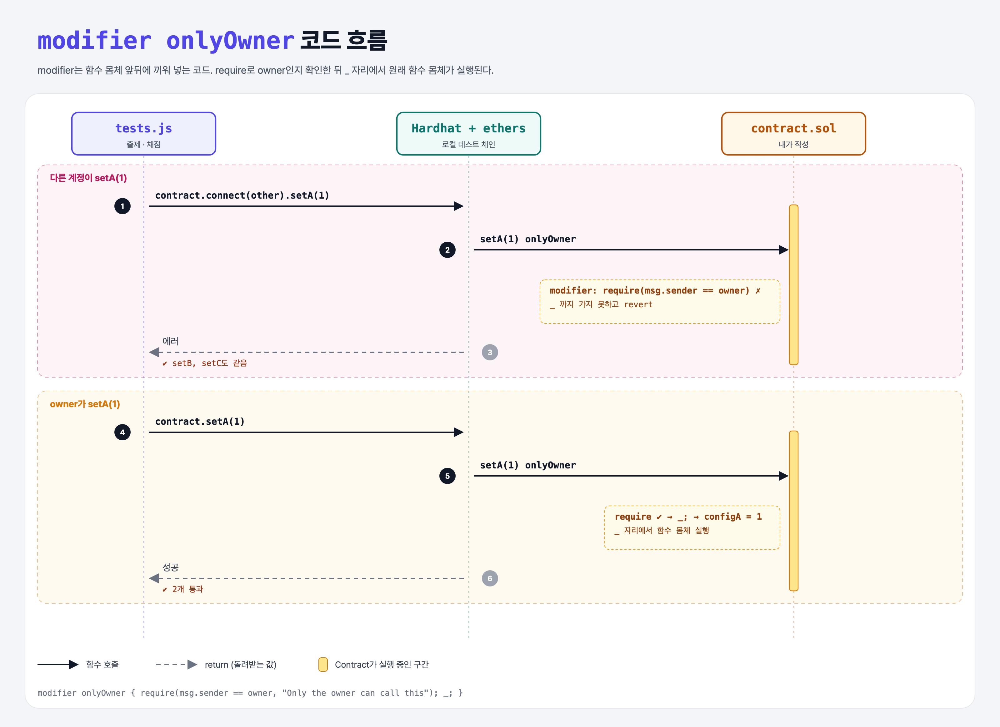

# Function Modifiers (Learning Revert 3단계)

## 문제

`setA`, `setB`, `setC`에 붙어 있는 `onlyOwner` modifier를 완성해서, owner만 이 함수들을 부를 수 있게 하기.

## 한 줄 요약

`modifier onlyOwner { require(msg.sender == owner); _; }` — 공통 검사를 한곳에 모아 여러 함수에 붙인다.



---

## 0. 이 과제가 말하려는 것

> **modifier = 함수 앞뒤에 끼워 넣는 코드 조각. `_` 자리에서 원래 함수 몸체가 실행된다.**

```
constructor-revert → owner-withdrawal → [modifier]
                                         ★ 이 단계
```

```solidity
modifier logModifier {
    console.log("before");
    _;                       // ← 여기서 함수 몸체 실행
    console.log("after");
}
// 출력 순서: before → during → after
```

Python의 **데코레이터**와 비슷하다:

```python
def only_owner(func):
    def wrapper(self, *args):
        if msg.sender != self.owner: raise Exception("Only the owner")
        return func(self, *args)      # ← _; 자리
    return wrapper
```

---

## 1. 파일 구성

| 파일 | 역할 |
|------|------|
| `contract.sol` | **onlyOwner 채우기** (setA/B/C는 주어짐) |
| `tests.js` | 출제 · 채점 (테스트 2개) |

---

## 2. 정답 코드

```solidity
modifier onlyOwner {
    require(msg.sender == owner, "Only the owner can call this");

    _;
}
```

---

## 3. tests.js 한 줄씩

```js
const methodName = `set${val}`;                         // 'setA', 'setB', 'setC'
await contract.connect(other)[methodName](1);           // 다른 계정 → 에러가 나야 함
await contract[methodName](1);                          // owner(계정 0) → 성공해야 함
```

---

## 4. 일부러 틀려 보면

| 바꾼 것 | 결과 |
|---------|------|
| `_;` 빼먹음 | 검사는 되지만 **함수 몸체가 실행되지 않음** (값이 안 바뀜). 이 테스트는 값을 확인하지 않아서 통과해 버린다 |
| require만 있고 `_;` 앞뒤 순서를 바꿈 | 몸체를 먼저 실행하고 검사 → revert되긴 하지만 가스 낭비 |

---

## 5. 실행 방법

```bash
sh tools/sol-test.sh week4/only-owner-modifier
```

## 로컬 실행 환경 메모

강의 사이트는 브라우저 안에서 Hardhat으로 컴파일·테스트한다. 로컬에서도 똑같이 하려고 루트에 Hardhat(`hardhat@2.22`, `@nomiclabs/hardhat-ethers@2` = ethers v5)을 설치하고 `hardhat.config.js`를 만들었다. `STAGE` 환경 변수로 단계 폴더를 골라 그 폴더의 `.sol`만 컴파일한다. 테스트 파일의 전역 `ethers`는 Hardhat이 넣어 준다.

이 문제는 `pragma solidity ^0.7.5;`라서 0.7.5 컴파일러로 컴파일된다.

## 기억할 것

1. modifier = 공통 검사 모음, `_` = 함수 몸체 자리.
2. Python 데코레이터와 비슷한 역할.
