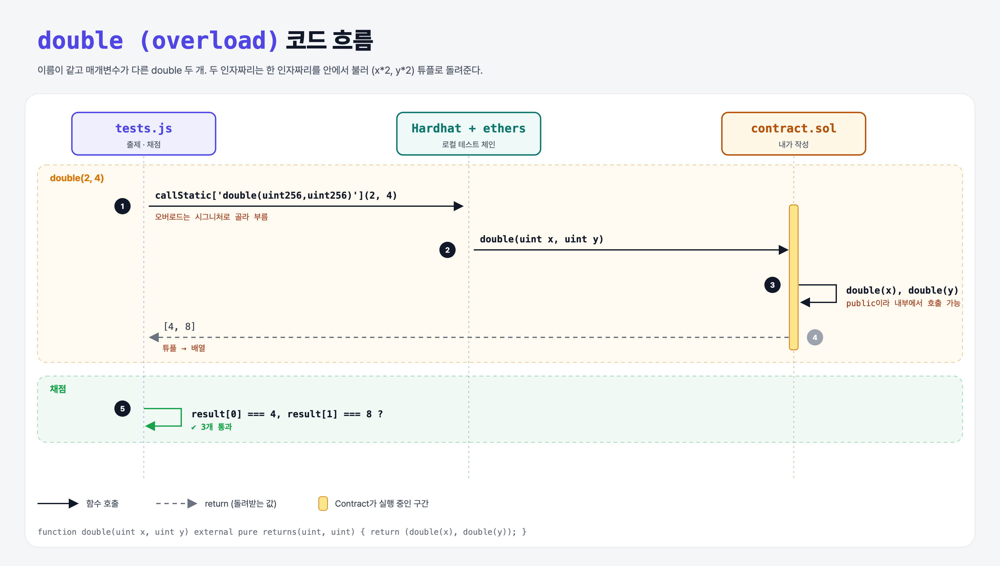

# Overloading Functions (Functions 5단계)

## 문제

uint **두 개**를 받는 `double`을 하나 더 만들기 (**오버로딩**). 둘 다 두 배로 만들어 받은 순서대로 **두 값을 함께** 돌려준다.

## 한 줄 요약

이름이 같아도 매개변수가 다르면 다른 함수. 값 여러 개는 **튜플** `(a, b)`로 돌려준다.



---

## 0. 이 과제가 말하려는 것

```
… → pure-double → [오버로딩]
                   ★ 이 단계
```

- `add(2, 4)`는 두 인자짜리, `add(2, 3, 4)`는 세 인자짜리가 불린다.
- 튜플은 정식 타입은 아니고, 여러 값을 잠깐 묶어 반환하거나 나눠 받는 데 쓴다: `(uint a, uint b) = addTwo(4, 8);` (Python의 `a, b = add_two(4, 8)`과 같음).
- Python은 오버로딩이 없고(같은 이름이면 덮어씀), 기본값 인자로 비슷하게 흉내 낸다.

---

## 1. 파일 구성

| 파일 | 역할 |
|------|------|
| `contract.sol` | 한 인자 double + **두 인자 double** |
| `tests.js` | 출제 · 채점 (테스트 3개) |

---

## 2. 정답 코드

```solidity
function double(uint x) public pure returns(uint) {       // external → public으로 바꿈
    return x * 2;
}

function double(uint x, uint y) external pure returns(uint, uint) {
    return (double(x), double(y));
}
```

- 한 인자짜리를 **안에서** 부르려면 `external`이면 안 되고 `public`이어야 한다.

---

## 3. tests.js 한 줄씩

```js
const result = await contract.callStatic["double(uint256,uint256)"](x, y);
assert.equal(result[0], x2);
assert.equal(result[1], y2);
```

- 같은 이름이 둘이라 `contract.double`로는 어느 것인지 모른다. ethers에서는 **시그니처 문자열**로 골라 부른다. `uint`는 ABI에서 `uint256`으로 표기된다.

---

## 4. 일부러 틀려 보면

| 바꾼 것 | 결과 |
|---------|------|
| 한 인자 double을 `external`로 둔 채 안에서 호출 | 컴파일 에러: external 함수는 내부에서 이름으로 못 부름 |

---

## 5. 실행 방법

```bash
sh tools/sol-test.sh week4/overload-double
```

## 로컬 실행 환경 메모

강의 사이트는 브라우저 안에서 Hardhat으로 컴파일·테스트한다. 로컬에서도 똑같이 하려고 루트에 Hardhat(`hardhat@2.22`, `@nomiclabs/hardhat-ethers@2` = ethers v5)을 설치하고 `hardhat.config.js`를 만들었다. `STAGE` 환경 변수로 단계 폴더를 골라 그 폴더의 `.sol`만 컴파일한다. 테스트 파일의 전역 `ethers`는 Hardhat이 넣어 준다.

## 기억할 것

1. 오버로딩 = 같은 이름, 다른 매개변수.
2. 여러 값 반환 = 튜플 `returns(uint, uint)` + `return (a, b)`.
3. ethers에서 오버로드 함수는 `"이름(타입,타입)"`으로 부른다.
