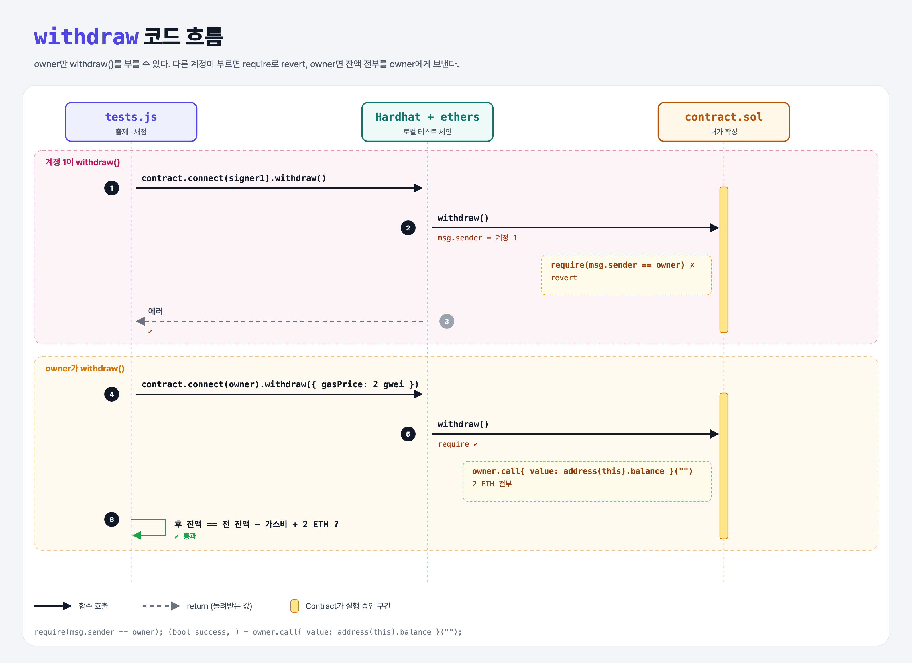

# Only Owner (Learning Revert 2단계)

## 문제

public 함수 `withdraw`를 만들어 컨트랙트의 모든 자금을 **배포자에게** 보내기. 배포자가 아닌 계정이 부르면 revert.

## 한 줄 요약

constructor에서 `owner = msg.sender`를 기억해 두고, `withdraw`에서 `require(msg.sender == owner)`로 막는다.



---

## 0. 이 과제가 말하려는 것

> **public 함수라도 "누가 부를 수 있는지"를 코드로 제한할 수 있다. 접근 제어(access control)의 기본.**

```
constructor-revert → [owner만 출금] → modifier
                      ★ 이 단계
```

---

## 1. 파일 구성

| 파일 | 역할 |
|------|------|
| `contract.sol` | constructor-revert + **owner, withdraw** |
| `tests.js` | 출제 · 채점 (테스트 2개) |

---

## 2. 정답 코드

```solidity
address owner;

constructor() payable {
    require(msg.value >= 1 ether, "Deposit at least 1 ether");
    owner = msg.sender;
}

function withdraw() public {
    require(msg.sender == owner, "Only the owner can withdraw");
    (bool success, ) = owner.call{ value: address(this).balance }("");
    require(success, "Withdraw failed");
}
```

---

## 3. tests.js 한 줄씩

```js
await contract.connect(signer1).withdraw();         // 에러가 나야 통과

const gasPrice = ethers.utils.parseUnits("2", "gwei");
const tx = await contract.connect(owner).withdraw({ gasPrice });
const receipt = await tx.wait();
const etherUsed = receipt.gasUsed.mul(gasPrice);    // 실제로 낸 가스비
assert.equal(balanceAfter.toString(), balanceBefore.sub(etherUsed).add(value).toString(), "...");
```

- owner가 거래를 보내니 **가스비를 빼고** 2 ETH가 늘었는지 확인한다. gasPrice를 고정해야 가스비를 정확히 계산할 수 있다.

---

## 4. 일부러 틀려 보면

| 바꾼 것 | 결과 |
|---------|------|
| require 없이 출금 | 아무나 돈을 빼 갈 수 있음 → 첫 테스트 실패 |
| `payable(msg.sender)`로 보내기 | owner 확인 뒤라 동작은 같지만, 확인 없이 이렇게 쓰면 위험 |

---

## 5. 실행 방법

```bash
sh tools/sol-test.sh week4/owner-withdrawal
```

## 로컬 실행 환경 메모

강의 사이트는 브라우저 안에서 Hardhat으로 컴파일·테스트한다. 로컬에서도 똑같이 하려고 루트에 Hardhat(`hardhat@2.22`, `@nomiclabs/hardhat-ethers@2` = ethers v5)을 설치하고 `hardhat.config.js`를 만들었다. `STAGE` 환경 변수로 단계 폴더를 골라 그 폴더의 `.sol`만 컴파일한다. 테스트 파일의 전역 `ethers`는 Hardhat이 넣어 준다.

## 기억할 것

1. 권한 확인 = `require(msg.sender == owner)`.
2. 영수증의 `gasUsed × gasPrice` = 실제 가스비.
