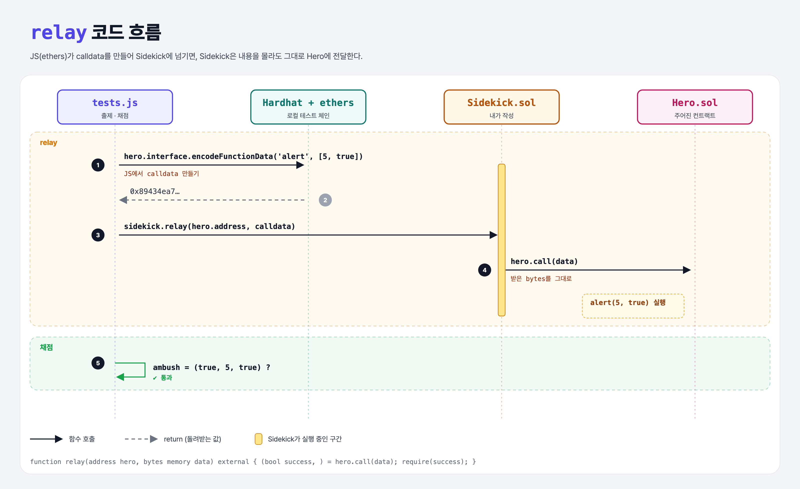

# Taking Calldata (Sending Data 4단계)

## 문제

Sidekick의 `relay(address hero, bytes data)`가 받은 데이터를 **그대로** Hero에 calldata로 보내게 하기.

## 한 줄 요약

`hero.call(data)` — 무엇을 부를지는 호출하는 사람이 정하고, Sidekick은 전달만 한다.



---

## 0. 이 과제가 말하려는 것

> **calldata를 받아 두었다가 나중에 실행할 수 있다. 여러 명이 승인해야 실행되는 멀티시그 지갑이나 DAO가 이 방식을 쓴다 (6, 7주차).**

```
… → encode-with-signature → [calldata 전달] → fallback
                             ★ 이 단계
```

---

## 1. 파일 구성

| 파일 | 역할 |
|------|------|
| `Sidekick.sol` | **relay 채우기** |
| `Hero.sol` | encode-with-signature와 같음 |
| `tests.js` | 출제 · 채점 (테스트 1개) |

---

## 2. 정답 코드

```solidity
function relay(address hero, bytes memory data) external {
    (bool success, ) = hero.call(data);
    require(success);
}
```

- `bytes memory`: 길이가 정해지지 않은 바이트 배열을 함수 실행 중 임시 메모리에 둔다.

---

## 3. tests.js 한 줄씩

```js
const calldata = hero.interface.encodeFunctionData('alert', [5, true]);   // JS에서 calldata 만들기
// = 0x89434ea7 00…05 00…01  (encode-with-signature와 같은 값)
await sidekick.relay(hero.address, calldata);
```

---

## 5. 실행 방법

```bash
sh tools/sol-test.sh week4/pass-calldata
```

## 로컬 실행 환경 메모

강의 사이트는 브라우저 안에서 Hardhat으로 컴파일·테스트한다. 로컬에서도 똑같이 하려고 루트에 Hardhat(`hardhat@2.22`, `@nomiclabs/hardhat-ethers@2` = ethers v5)을 설치하고 `hardhat.config.js`를 만들었다. `STAGE` 환경 변수로 단계 폴더를 골라 그 폴더의 `.sol`만 컴파일한다. 테스트 파일의 전역 `ethers`는 Hardhat이 넣어 준다.

## 기억할 것

1. calldata는 그냥 bytes → 저장·전달할 수 있다.
2. JS: `contract.interface.encodeFunctionData(이름, [인자])`.
