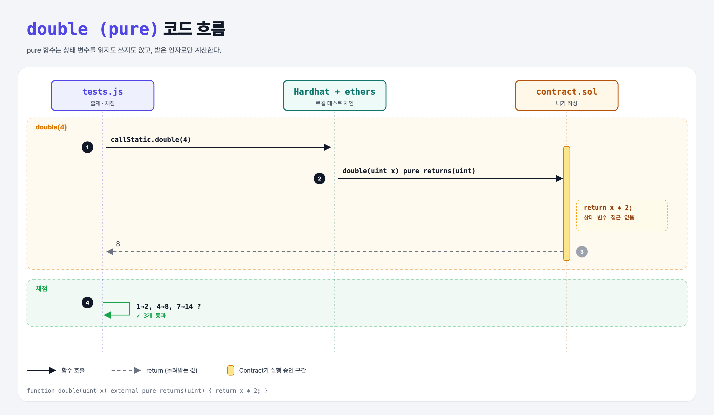

# Pure Double (Functions 4단계)

## 문제

uint 하나를 받아 **두 배**를 돌려주는 external **pure** 함수 `double` 만들기.

## 한 줄 요약

`pure` = 상태를 **읽지도 쓰지도 않는** 함수. 인자만으로 계산한다.



---

## 0. 이 과제가 말하려는 것

```
… → view-addition → [pure] → 오버로딩
                     ★ 이 단계
```

| 키워드 | 상태 읽기 | 상태 쓰기 |
|--------|-----------|-----------|
| (없음) | ✔ | ✔ |
| `view` | ✔ | ✘ |
| `pure` | ✘ | ✘ |

이름 붙은 반환값 문법도 있다:

```solidity
function double(uint x) external pure returns(uint doubled) {
    doubled = x * 2;      // return 없이 자동 반환
}
```

---

## 1. 파일 구성

| 파일 | 역할 |
|------|------|
| `contract.sol` | **double** (이번 단계는 새 컨트랙트) |
| `tests.js` | 출제 · 채점 (테스트 3개) |

---

## 2. 정답 코드

```solidity
function double(uint x) external pure returns(uint) {
    return x * 2;
}
```

---

## 4. 일부러 틀려 보면

| 바꾼 것 | 결과 |
|---------|------|
| pure 함수에서 상태 변수 읽기 | 컴파일 에러: "Function declared as pure, but this expression reads from the environment or state" |

---

## 5. 실행 방법

```bash
sh tools/sol-test.sh week4/pure-double
```

## 로컬 실행 환경 메모

강의 사이트는 브라우저 안에서 Hardhat으로 컴파일·테스트한다. 로컬에서도 똑같이 하려고 루트에 Hardhat(`hardhat@2.22`, `@nomiclabs/hardhat-ethers@2` = ethers v5)을 설치하고 `hardhat.config.js`를 만들었다. `STAGE` 환경 변수로 단계 폴더를 골라 그 폴더의 `.sol`만 컴파일한다. 테스트 파일의 전역 `ethers`는 Hardhat이 넣어 준다.

## 기억할 것

1. pure = 입력만으로 계산하는 함수.
2. 이름 붙은 반환값: `returns(uint name)` + `name = …`.
