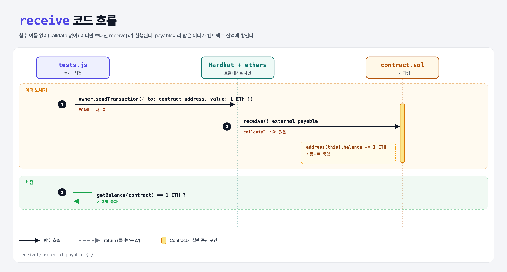

# Receive Ether (Sending Ether 2단계)

## 문제

calldata 없이 이더만 보내는 거래를 컨트랙트가 **받을 수 있게** 하기.

## 한 줄 요약

`receive() external payable { }` — 이 특별한 함수가 있어야 컨트랙트가 그냥 송금을 받는다.



---

## 0. 이 과제가 말하려는 것

> **요즘 Solidity 컨트랙트는 기본적으로 이더를 거절한다. 받으려면 `payable` 함수가 있어야 한다.**

```
storing-owner → [이더 받기] → 팁 보내기 → 기부하기 → selfdestruct
                 ★ 이 단계
```

| stateMutability | 뜻 |
|-----------------|-----|
| `view` | 상태 읽기만 |
| `pure` | 상태 안 건드림 |
| `payable` | 이더를 받을 수 있음 |
| `nonpayable` | (기본값) 이더를 보내면 실패 |

- `receive`는 `constructor`처럼 `function` 키워드 없이 쓰는 특별 함수. 반드시 `external payable`, 인자·반환값 없음.
- 함수 이름이 안 맞는 호출은 `fallback()`이 받는다 (payable로 만들면 이더도 받음).

---

## 1. 파일 구성

| 파일 | 역할 |
|------|------|
| `contract.sol` | storing-owner + **receive** |
| `tests.js` | 출제 · 채점 (테스트 2개) |

---

## 2. 정답 코드

```solidity
receive() external payable { }
```

몸체가 비어 있어도 받은 이더는 자동으로 컨트랙트 잔액(`address(this).balance`)에 쌓인다.

---

## 3. tests.js 한 줄씩

```js
owner = ethers.provider.getSigner(0);
await owner.sendTransaction({ to: contract.address, value });   // EOA끼리 송금하듯이
const balance = await ethers.provider.getBalance(contract.address);
assert(balance.eq(value), "expected the ether to be received");
```

---

## 4. 일부러 틀려 보면

| 바꾼 것 | 결과 |
|---------|------|
| receive 없음 | 송금 거래가 revert → 테스트 준비(before)에서 에러 |

---

## 5. 실행 방법

```bash
sh tools/sol-test.sh week4/receive-ether
```

## 로컬 실행 환경 메모

강의 사이트는 브라우저 안에서 Hardhat으로 컴파일·테스트한다. 로컬에서도 똑같이 하려고 루트에 Hardhat(`hardhat@2.22`, `@nomiclabs/hardhat-ethers@2` = ethers v5)을 설치하고 `hardhat.config.js`를 만들었다. `STAGE` 환경 변수로 단계 폴더를 골라 그 폴더의 `.sol`만 컴파일한다. 테스트 파일의 전역 `ethers`는 Hardhat이 넣어 준다.

## 기억할 것

1. 그냥 송금 받기 = `receive() external payable`.
2. 함수에 이더를 받으려면 `payable`.
