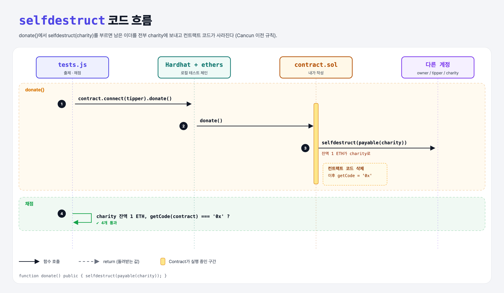

# Self Destruct (Sending Ether 5단계)

## 문제

`donate()`가 불리면 **selfdestruct**로 컨트랙트를 없애고, 남은 이더를 자선 단체로 보내기.

## 한 줄 요약

`selfdestruct(payable(charity));` — 남은 잔액을 그 주소로 보내고 컨트랙트 코드를 지운다.



---

## 0. 이 과제가 말하려는 것

> **안 쓰는 컨트랙트를 정리하는 기능. 단, 2024년 Cancun 업그레이드(EIP-6780) 이후로는 같은 거래 안에서 만든 컨트랙트가 아니면 코드를 지우지 않고 이더만 보낸다.**

```
… → charity → [selfdestruct]
               ★ 이 단계
```

- `payable(...)`: 이더를 보낼 수 있는 주소 타입으로 바꾼다. 실수로 이더를 보내는 걸 막으려고 보통 주소와 구분한다.
- 지운 컨트랙트에 나중에 이더를 보내면 **돌려받을 방법이 없다**. 그래서 selfdestruct는 위험하고 사용이 권장되지 않는다 (컴파일러도 경고).

---

## 1. 파일 구성

| 파일 | 역할 |
|------|------|
| `contract.sol` | charity의 donate를 **selfdestruct로 교체** |
| `tests.js` | 출제 · 채점 (테스트 4개) |

---

## 2. 정답 코드

```solidity
function donate() public {
    selfdestruct(payable(charity));
}
```

---

## 3. tests.js 한 줄씩

```js
await contract.connect(tipper).donate();
assert.equal((await ethers.provider.getBalance(charity)).toString(), donation.toString());
const bytecode = await ethers.provider.getCode(contract.address);   // 그 주소의 컨트랙트 코드
assert.equal(bytecode, "0x");                                       // 비어 있어야 함 = 삭제됨
```

---

## 4. 로컬 실행 차이

최신 Hardhat은 기본이 Cancun 규칙이라 selfdestruct 후에도 코드가 남아서 마지막 테스트가 실패한다. 강의 환경과 맞추려고 `hardhat.config.js`에서 로컬 체인을 `hardfork: "shanghai"`(Cancun 이전)로 설정했다.

---

## 5. 실행 방법

```bash
sh tools/sol-test.sh week4/self-destruct
```

## 로컬 실행 환경 메모

강의 사이트는 브라우저 안에서 Hardhat으로 컴파일·테스트한다. 로컬에서도 똑같이 하려고 루트에 Hardhat(`hardhat@2.22`, `@nomiclabs/hardhat-ethers@2` = ethers v5)을 설치하고 `hardhat.config.js`를 만들었다. `STAGE` 환경 변수로 단계 폴더를 골라 그 폴더의 `.sol`만 컴파일한다. 테스트 파일의 전역 `ethers`는 Hardhat이 넣어 준다.

## 기억할 것

1. `selfdestruct(payable(addr))` = 잔액을 addr로 + 코드 삭제 (Cancun 이후엔 코드는 남음).
2. 비권장 기능이다.
