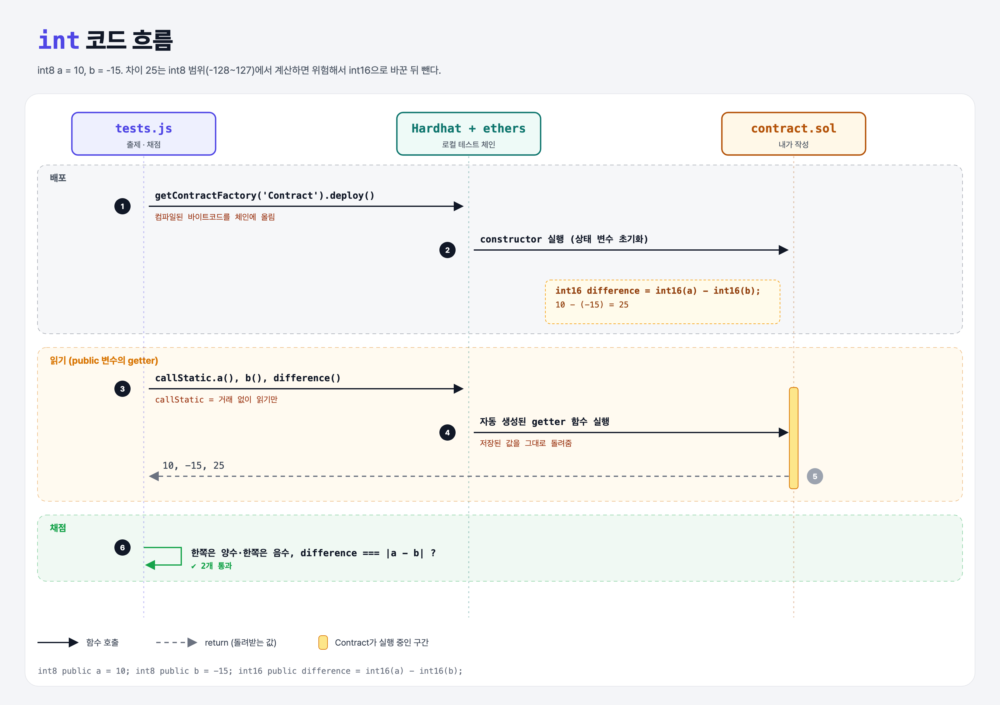

# Signed Integers (Data Types 3단계)

## 문제

public 상태 변수 세 개:

- `a`, `b`: `int8`, 하나는 양수·하나는 음수
- `difference`: `int16`, 둘의 차이의 절댓값

## 한 줄 요약

`int` = 음수도 되는 정수. 양수에서 음수를 빼면 절댓값 차이가 된다: `10 - (-15) = 25`.



---

## 0. 이 과제가 말하려는 것

```
booleans → unsigned-integers → [int] → 문자열 → enum
                                ★ 이 단계
```

| 타입 | 범위 |
|------|------|
| `uint8` | 0 ~ 255 |
| `int8` | −128 ~ 127 |

둘 다 8비트로 256가지 값을 표현한다. int는 그중 절반을 음수에 쓴다.

---

## 1. 파일 구성

| 파일 | 역할 |
|------|------|
| `contract.sol` | **이번에 완성할 컨트랙트** |
| `tests.js` | 출제 · 채점 (테스트 2개) |

---

## 2. 정답 코드

```solidity
contract Contract {
    int8 public a = 10;
    int8 public b = -15;
    int16 public difference = int16(a) - int16(b);
}
```

- `int16(a)`처럼 먼저 **큰 타입으로 바꾼(형 변환)** 뒤 뺀다. `a - b`는 int8끼리 계산되어서, 값에 따라 int8 범위(127)를 넘으면 에러가 난다. 예: `100 - (-100) = 200` → int8에서는 overflow.

---

## 3. tests.js 한 줄씩

```js
const aPositive = a > 0 && b < 0;
const bPositive = b > 0 && a < 0;
assert(aPositive || bPositive, "...");
assert.equal(difference, Math.abs(a - b));
```

---

## 4. 일부러 틀려 보면

| 바꾼 것 | 결과 |
|---------|------|
| `int8 public a = 100; int8 public b = -100;` + `a - b` | int8 계산이 200에서 넘쳐 **배포 중 revert** |
| `int16 difference = b - a` | −25 → 절댓값과 달라 실패 |

---

## 5. 실행 방법

```bash
sh tools/sol-test.sh week4/signed-integers
```

## 로컬 실행 환경 메모

강의 사이트는 브라우저 안에서 Hardhat으로 컴파일·테스트한다. 로컬에서도 똑같이 하려고 루트에 Hardhat(`hardhat@2.22`, `@nomiclabs/hardhat-ethers@2` = ethers v5)을 설치하고 `hardhat.config.js`를 만들었다. `STAGE` 환경 변수로 단계 폴더를 골라 그 폴더의 `.sol`만 컴파일한다. 테스트 파일의 전역 `ethers`는 Hardhat이 넣어 준다.

## 기억할 것

1. intN = −2ᴺ⁻¹ ~ 2ᴺ⁻¹−1.
2. 결과가 커질 수 있으면 **먼저 큰 타입으로 바꾼 뒤** 계산.
