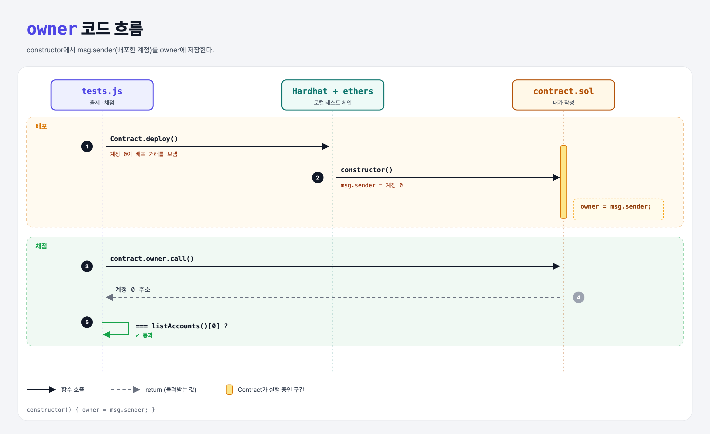

# Storing Owner (Sending Ether 1단계)

## 문제

public `address` 상태 변수 `owner`를 만들고, constructor에서 `msg.sender`를 저장하기.

## 한 줄 요약

`owner = msg.sender;` — 배포한 계정을 관리자로 기억해 둔다.



---

## 0. 이 과제가 말하려는 것

> **`msg.sender`는 지금 이 함수를 부른 계정이다. constructor에서는 배포한 사람.**

```
[owner 저장] → 이더 받기 → 팁 보내기 → 기부하기 → selfdestruct
 ★ 이 단계   receive-ether  transfer-tips  charity  self-destruct
```

- `address`: 20바이트(160비트, 16진수 40글자) 이더리움 주소 타입.
- `msg`에는 `msg.sender`(보낸 사람), `msg.value`(같이 보낸 wei), `msg.data`(calldata) 등이 들어 있다.
- 관리자 역할은 편하지만, 한 계정에 권한이 몰리면 탈중앙성이 떨어진다는 점도 생각해야 한다.

---

## 1. 파일 구성

| 파일 | 역할 |
|------|------|
| `contract.sol` | **이번에 완성할 컨트랙트** |
| `tests.js` | 출제 · 채점 (테스트 1개) |

---

## 2. 정답 코드

```solidity
contract Contract {
    address public owner;

    constructor() {
        owner = msg.sender;
    }
}
```

---

## 3. tests.js 한 줄씩

```js
const _owner = await contract.owner.call();          // owner() 호출
const [owner] = await ethers.provider.listAccounts(); // Hardhat 계정 0 (배포자)
assert.equal(_owner, owner);
```

---

## 5. 실행 방법

```bash
sh tools/sol-test.sh week4/storing-owner
```

## 로컬 실행 환경 메모

강의 사이트는 브라우저 안에서 Hardhat으로 컴파일·테스트한다. 로컬에서도 똑같이 하려고 루트에 Hardhat(`hardhat@2.22`, `@nomiclabs/hardhat-ethers@2` = ethers v5)을 설치하고 `hardhat.config.js`를 만들었다. `STAGE` 환경 변수로 단계 폴더를 골라 그 폴더의 `.sol`만 컴파일한다. 테스트 파일의 전역 `ethers`는 Hardhat이 넣어 준다.

## 기억할 것

1. `msg.sender` = 호출한 계정.
2. constructor에서 저장하면 배포자 = owner.
