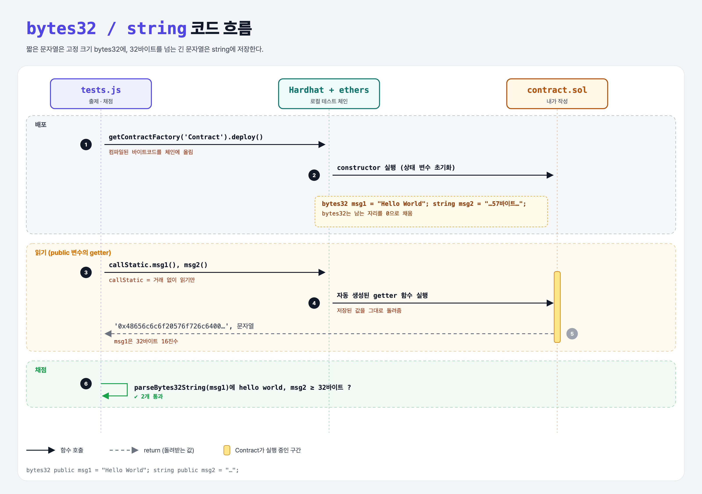

# String Literals (Data Types 4단계)

## 문제

- `msg1`: `bytes32`, "Hello World"가 들어간 문자열
- `msg2`: `string`, 32바이트가 넘는 문자열

## 한 줄 요약

짧은(32바이트 이하) 문자열은 **고정 크기 `bytes32`**, 긴 문자열은 **가변 크기 `string`**.



---

## 0. 이 과제가 말하려는 것

> **체인 저장은 비싸다. 크기를 미리 아는 데이터(bytes32)가 더 싸고, 긴 문서는 보통 체인 밖(IPFS 등)에 두고 해시만 체인에 둔다.**

```
… → signed-integers → [문자열] → enum
                       ★ 이 단계
```

- UTF-8에서 `c`는 1바이트, `ć`는 2바이트, 한글은 보통 3바이트. 그래서 bytes32에는 영문 32자, 한글은 10자 정도만 들어간다.

---

## 1. 파일 구성

| 파일 | 역할 |
|------|------|
| `contract.sol` | **이번에 완성할 컨트랙트** |
| `tests.js` | 출제 · 채점 (테스트 2개) |

---

## 2. 정답 코드

```solidity
contract Contract {
    bytes32 public msg1 = "Hello World";
    string public msg2 = "This message is definitely longer than thirty-two bytes!";
}
```

---

## 3. tests.js 한 줄씩

```js
const msg1 = await contract.callStatic.msg1();          // '0x48656c6c6f20576f726c64000000…' (32바이트 16진수)
const ascii = ethers.utils.parseBytes32String(msg1);    // 'Hello World' (뒤의 0은 잘라냄)
assert(/hello world/i.test(ascii), "...");
assert.isAtLeast(Buffer.byteLength(msg2, 'utf8'), 32);  // 바이트 수 (글자 수 X)
```

---

## 4. 일부러 틀려 보면

| 바꾼 것 | 결과 |
|---------|------|
| bytes32에 33자 넣기 | 컴파일 에러: 리터럴이 32바이트를 넘음 |
| msg2를 짧게 | 32바이트 미만 → 실패 |

---

## 5. 실행 방법

```bash
sh tools/sol-test.sh week4/string-literals
```

## 로컬 실행 환경 메모

강의 사이트는 브라우저 안에서 Hardhat으로 컴파일·테스트한다. 로컬에서도 똑같이 하려고 루트에 Hardhat(`hardhat@2.22`, `@nomiclabs/hardhat-ethers@2` = ethers v5)을 설치하고 `hardhat.config.js`를 만들었다. `STAGE` 환경 변수로 단계 폴더를 골라 그 폴더의 `.sol`만 컴파일한다. 테스트 파일의 전역 `ethers`는 Hardhat이 넣어 준다.

## 기억할 것

1. bytes32 = 고정 32바이트, string = 가변.
2. 길이는 **바이트** 기준 (글자 수와 다를 수 있음).
