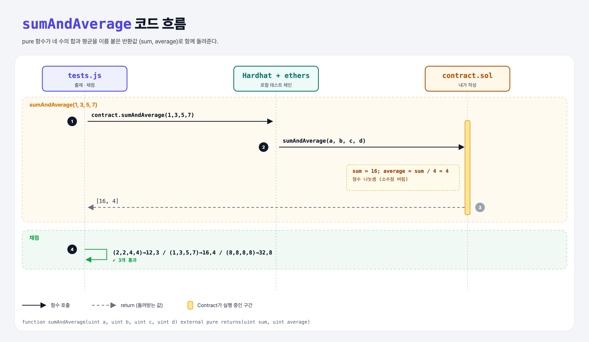

# Sum and Average

## 문제

uint 네 개를 받아 **합과 평균**을 이 순서대로 돌려주는 external pure 함수 `sumAndAverage` 만들기.

## 한 줄 요약

이름 붙은 반환값 `returns(uint sum, uint average)`에 값을 넣으면 자동으로 둘 다 반환된다.



---

## 0. 이 과제가 말하려는 것

> **Practice Solidity 첫 문제. pure 함수, 여러 값 반환, 정수 나눗셈을 복습한다.**

- Solidity에는 소수가 없다. `/`는 **정수 나눗셈**(소수점 버림). Python의 `//`와 같다. 테스트 값들은 모두 4로 나누어떨어지게 골라져 있다.

---

## 1. 파일 구성

| 파일 | 역할 |
|------|------|
| `contract.sol` | **이번에 완성할 컨트랙트** |
| `tests.js` | 출제 · 채점 (테스트 3개) |

---

## 2. 정답 코드

```solidity
function sumAndAverage(uint a, uint b, uint c, uint d) external pure returns(uint sum, uint average) {
    sum = a + b + c + d;
    average = sum / 4;
}
```

```python
def sum_and_average(a, b, c, d):
    s = a + b + c + d
    return s, s // 4
```

---

## 3. tests.js 한 줄씩

```js
const values = await contract.sumAndAverage(a, b, c, d);   // pure → 거래 없이 바로 결과
assert.equal(values[0], expectedSum);
assert.equal(values[1], expectedAverage);
```

- 이름 붙은 반환값이라 `values.sum`, `values.average`로도 읽을 수 있다.

---

## 5. 실행 방법

```bash
sh tools/sol-test.sh week4/sum-and-average
```

## 로컬 실행 환경 메모

강의 사이트는 브라우저 안에서 Hardhat으로 컴파일·테스트한다. 로컬에서도 똑같이 하려고 루트에 Hardhat(`hardhat@2.22`, `@nomiclabs/hardhat-ethers@2` = ethers v5)을 설치하고 `hardhat.config.js`를 만들었다. `STAGE` 환경 변수로 단계 폴더를 골라 그 폴더의 `.sol`만 컴파일한다. 테스트 파일의 전역 `ethers`는 Hardhat이 넣어 준다.

## 기억할 것

1. `/`는 정수 나눗셈.
2. 이름 붙은 반환값은 대입만 하면 반환된다.
