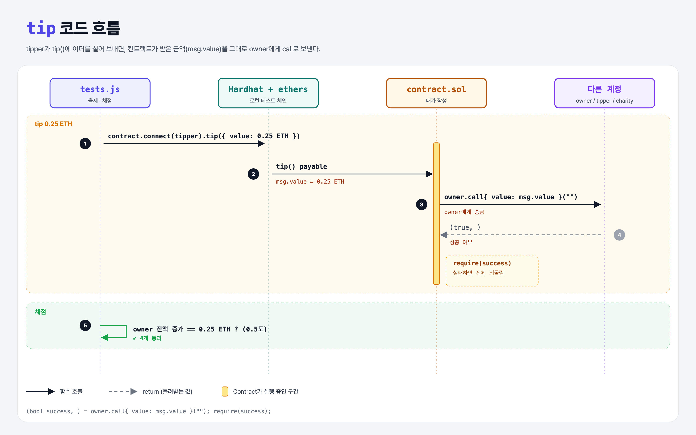

# Transferring Funds (Sending Ether 3단계)

## 문제

public payable 함수 `tip`을 만들어서, 받은 이더를 전부 `owner`에게 보내기.

## 한 줄 요약

`(bool success, ) = owner.call{ value: msg.value }(""); require(success);` — 컨트랙트가 받은 돈을 다른 주소로 넘긴다.



---

## 0. 이 과제가 말하려는 것

> **컨트랙트도 계정이라 이더를 받고 보낼 수 있다. 보낼 때는 `.call{ value: … }("")`을 쓰고 성공 여부를 꼭 확인한다.**

```
storing-owner → receive-ether → [팁 보내기] → 기부하기 → selfdestruct
                                 ★ 이 단계
```

| 방법 | 특징 |
|------|------|
| `addr.call{ value: x }("")` | 권장. 성공 여부(bool)를 돌려줌 |
| `payable(addr).transfer(x)` | 가스 2300 제한, 실패하면 revert. 요즘은 비권장 |
| `payable(addr).send(x)` | 가스 2300 제한, bool 반환 |

---

## 1. 파일 구성

| 파일 | 역할 |
|------|------|
| `contract.sol` | receive-ether + **tip** |
| `tests.js` | 출제 · 채점 (테스트 4개) |

---

## 2. 정답 코드

```solidity
function tip() public payable {
    (bool success, ) = owner.call{ value: msg.value }("");
    require(success, "Tip failed");
}
```

| 코드 | 설명 |
|------|------|
| `msg.value` | 이 호출에 실려 온 wei |
| `owner.call{ value: … }("")` | owner에게 빈 calldata로 이더를 보냄 |
| `(bool success, )` | 반환값 두 개(성공 여부, 반환 데이터) 중 첫 번째만 받음 |
| `require(success, …)` | 실패하면 전체 거래를 되돌림 |

---

## 3. tests.js 한 줄씩

```js
tipper = ethers.provider.getSigner(1);
balanceBefore = await ethers.provider.getBalance(await owner.getAddress());
await contract.connect(tipper).tip({ value: tip });          // 0.25 ETH
const balanceAfter = await ethers.provider.getBalance(await owner.getAddress());
assert.equal(balanceAfter.sub(balanceBefore).toString(), tip);   // 정확히 0.25 ETH 늘었나
```

- tipper(계정 1)가 가스를 내므로 owner 잔액은 정확히 팁만큼 늘어난다.

---

## 4. 일부러 틀려 보면

| 바꾼 것 | 결과 |
|---------|------|
| `payable` 빼먹음 | `{ value }`를 보내면 revert |
| `require(success)` 생략 | 이번 테스트는 통과하지만, 받는 쪽이 거부하면 돈이 컨트랙트에 남은 채 조용히 성공 처리됨 |

---

## 5. 실행 방법

```bash
sh tools/sol-test.sh week4/transfer-tips
```

## 로컬 실행 환경 메모

강의 사이트는 브라우저 안에서 Hardhat으로 컴파일·테스트한다. 로컬에서도 똑같이 하려고 루트에 Hardhat(`hardhat@2.22`, `@nomiclabs/hardhat-ethers@2` = ethers v5)을 설치하고 `hardhat.config.js`를 만들었다. `STAGE` 환경 변수로 단계 폴더를 골라 그 폴더의 `.sol`만 컴파일한다. 테스트 파일의 전역 `ethers`는 Hardhat이 넣어 준다.

## 기억할 것

1. 이더 보내기: `addr.call{ value: x }("")` + `require(success)`.
2. 받은 금액 = `msg.value`.
