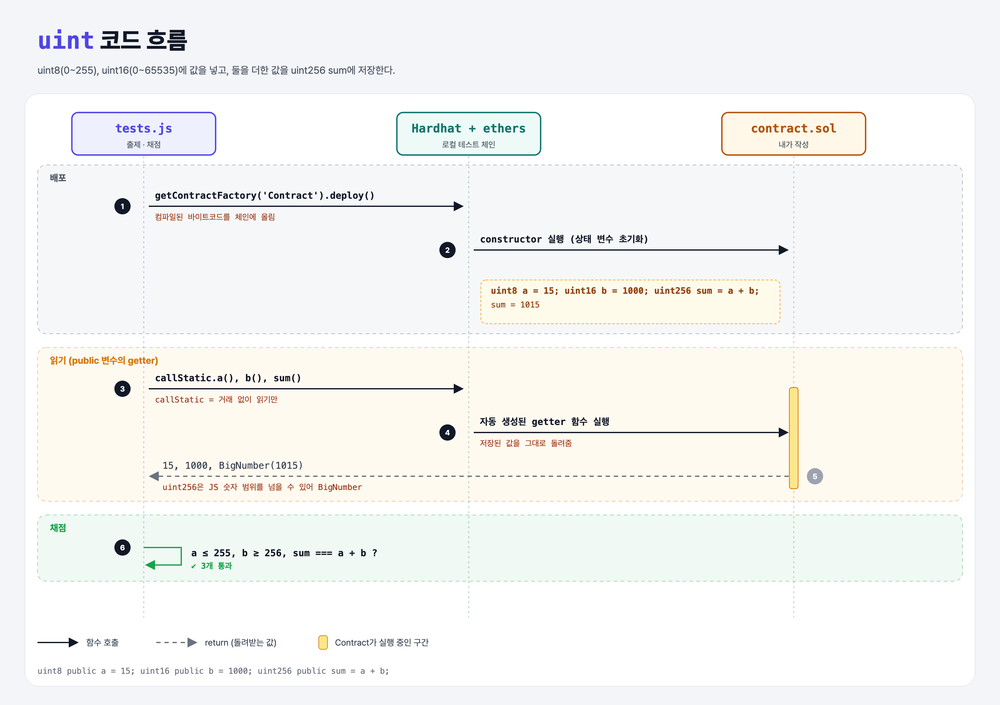

# Unsigned Integers (Data Types 2단계)

## 문제

public 상태 변수 세 개:

- `a`: `uint8`, 0~255 사이 값
- `b`: `uint16`, 256 이상
- `sum`: `uint256`, `a + b`

## 한 줄 요약

`uint` = 부호 없는(0 이상) 정수. 뒤의 숫자는 비트 수라서 표현 범위가 정해진다.



---

## 0. 이 과제가 말하려는 것

> **Solidity의 숫자는 크기가 정해져 있다. 범위를 넘으면 0.8 버전부터는 에러(revert)가 난다.**

```
booleans → [uint] → int → 문자열 → enum
            ★ 이 단계
```

| 타입 | 비트 | 범위 |
|------|------|------|
| `uint8` | 8 | 0 ~ 255 |
| `uint16` | 16 | 0 ~ 65,535 |
| `uint256` (= `uint`) | 256 | 0 ~ 약 1.16 × 10⁷⁷ |

- Python의 `int`는 크기 제한이 없지만 Solidity는 있다. 저장 공간이 곧 돈이라서.
- 0.8 이전에는 255 + 1이 조용히 0으로 돌아가는(overflow) 버그가 많았다. 지금은 자동으로 막는다.

---

## 1. 파일 구성

| 파일 | 역할 |
|------|------|
| `contract.sol` | **이번에 완성할 컨트랙트** |
| `tests.js` | 출제 · 채점 (테스트 3개) |

---

## 2. 정답 코드

```solidity
contract Contract {
    uint8 public a = 15;
    uint16 public b = 1000;
    uint256 public sum = a + b;
}
```

- 크기가 다른 uint끼리 더해서 더 큰 uint256에 넣는 건 괜찮다.
- 상태 변수 초기값에서 앞의 변수를 쓸 수 있다 (`a + b`).

---

## 3. tests.js 한 줄씩

```js
assert.isAtMost(a, 255);
assert.isAtLeast(b, 256);
const sum = await contract.callStatic.sum();
assert.equal(sum.toNumber(), a + b);     // uint256은 BigNumber로 와서 toNumber()
```

- ethers는 작은 타입(uint8, uint16 …, 최대 48비트)은 JS 숫자로, 큰 타입(uint256)은 **BigNumber**로 돌려준다.

---

## 4. 일부러 틀려 보면

| 바꾼 것 | 결과 |
|---------|------|
| `uint8 public a = 300;` | 컴파일 에러: 300은 uint8에 안 들어감 |
| `uint8 public sum = a + b;` | 컴파일 에러: uint16을 uint8에 암묵적으로 넣을 수 없음 |

---

## 5. 실행 방법

```bash
sh tools/sol-test.sh week4/unsigned-integers
```

## 로컬 실행 환경 메모

강의 사이트는 브라우저 안에서 Hardhat으로 컴파일·테스트한다. 로컬에서도 똑같이 하려고 루트에 Hardhat(`hardhat@2.22`, `@nomiclabs/hardhat-ethers@2` = ethers v5)을 설치하고 `hardhat.config.js`를 만들었다. `STAGE` 환경 변수로 단계 폴더를 골라 그 폴더의 `.sol`만 컴파일한다. 테스트 파일의 전역 `ethers`는 Hardhat이 넣어 준다.

## 기억할 것

1. uintN = 0 ~ 2ᴺ−1.
2. `uint` = `uint256`.
3. 큰 숫자는 JS에서 BigNumber.
