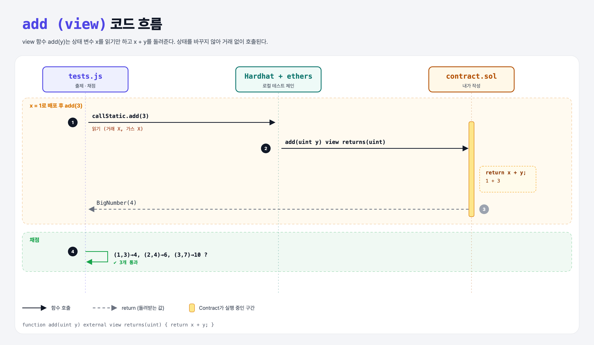

# View Addition (Functions 3단계)

## 문제

uint 하나를 받아 `x + 인자`를 **돌려주는** external **view** 함수 `add` 만들기. 상태는 바꾸면 안 된다.

## 한 줄 요약

`function add(uint y) external view returns(uint) { return x + y; }` — view = 읽기 전용.



---

## 0. 이 과제가 말하려는 것

> **함수가 무엇을 돌려주는지 `returns(...)`로 미리 선언한다. 이 정보로 ABI가 만들어져서 밖의 프로그램이 결과를 해석할 수 있다.**

```
… → increment → [view] → pure → 오버로딩
                 ★ 이 단계
```

- 거래로 호출한 함수의 return 값은 밖에서 받을 수 없다 (거래 결과는 영수증뿐). 그래서 return 값은 **쿼리(view/pure)나 내부 호출**에서만 의미가 있다.
- `view`를 붙이면 상태를 바꾸는 코드를 컴파일러가 막는다.

---

## 1. 파일 구성

| 파일 | 역할 |
|------|------|
| `contract.sol` | 앞 단계 + **add** |
| `tests.js` | 출제 · 채점 (테스트 3개) |

---

## 2. 정답 코드

```solidity
function add(uint y) external view returns(uint) {
    return x + y;
}
```

---

## 3. tests.js 한 줄씩

```js
[[1, 3], [2, 4], [3, 7]].forEach(([x, y]) => { ... });    // x로 배포하고 add(y) 호출
const sum = await contract.callStatic.add(y);
assert.equal(sum.toNumber(), expectedSum);
```

---

## 4. 일부러 틀려 보면

| 바꾼 것 | 결과 |
|---------|------|
| view 함수 안에서 `x += y;` | 컴파일 에러: view로 선언했는데 상태를 바꿈 |
| `returns(uint)` 빼먹고 `return` | 컴파일 에러: 반환 선언이 없는 함수에서 값을 return |

---

## 5. 실행 방법

```bash
sh tools/sol-test.sh week4/view-addition
```

## 로컬 실행 환경 메모

강의 사이트는 브라우저 안에서 Hardhat으로 컴파일·테스트한다. 로컬에서도 똑같이 하려고 루트에 Hardhat(`hardhat@2.22`, `@nomiclabs/hardhat-ethers@2` = ethers v5)을 설치하고 `hardhat.config.js`를 만들었다. `STAGE` 환경 변수로 단계 폴더를 골라 그 폴더의 `.sol`만 컴파일한다. 테스트 파일의 전역 `ethers`는 Hardhat이 넣어 준다.

## 기억할 것

1. `view` = 상태를 읽기만.
2. 반환 타입은 `returns(타입)`으로 선언.
