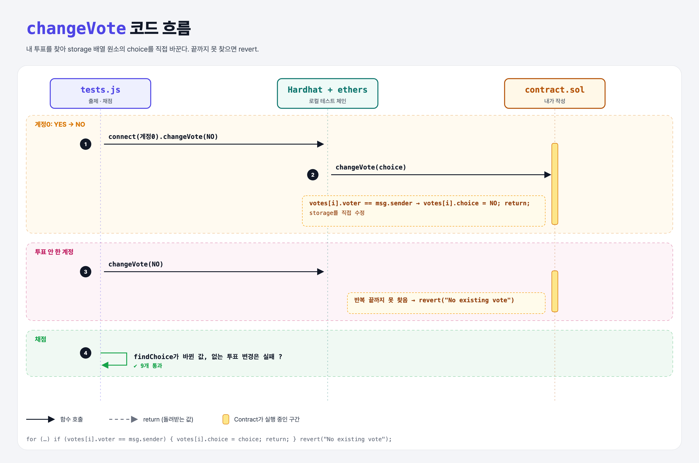

# Change Vote (Structs 6단계)

## 문제

external `changeVote(Choices)`: msg.sender의 기존 투표의 선택을 바꾸기. 기존 투표가 없으면 revert.

## 한 줄 요약

배열을 훑어 내 투표를 찾고 `votes[i].choice = choice;` (storage 원소를 직접 수정). 끝까지 못 찾으면 `revert`.



---

## 0. 이 과제가 말하려는 것

- `votes[i].choice = …`는 storage 배열 원소를 직접 고친다.
- `findVote`가 돌려주는 건 **memory 복사본**이라, 그걸 고쳐도 저장된 투표는 그대로다. 그래서 여기선 인덱스로 직접 접근했다.

---

## 1. 파일 구성

| 파일 | 역할 |
|------|------|
| `contract.sol` | vote-once + **changeVote** |
| `tests.js` | 출제 · 채점 (테스트 9개) |

---

## 2. 정답 코드

```solidity
function changeVote(Choices choice) external {
    for (uint i = 0; i < votes.length; i++) {
        if (votes[i].voter == msg.sender) {
            votes[i].choice = choice;
            return;
        }
    }
    revert("No existing vote");
}
```

---

## 3. 테스트 한 줄씩

```js
await contract.changeVote(CHOICES.NO, { from: a1 });   // 강의 테스트 원본 그대로
...
await contract.connect(accounts[0].signer).changeVote(CHOICES.NO);
assert.equal(await contract.findChoice(accounts[0].address), CHOICES.NO);
```

- 첫 테스트의 `a1`은 어디에도 선언되지 않은 변수라서, 이 줄은 컨트랙트까지 가기 전에 JS `ReferenceError`로 실패한다. 그래서 "에러가 났다"는 조건은 항상 참이 된다 (강의 테스트의 실수). 실제로 revert되는지는 다른 단계 테스트들과 코드로 확인했다.

---

## 4. 일부러 틀려 보면

| 바꾼 것 | 결과 |
|---------|------|
| `(, Vote memory v) = findVote(msg.sender); v.choice = choice;` | memory 복사본만 바뀌어 저장된 투표는 그대로 → 변경 테스트 실패 |

---

## 5. 실행 방법

```bash
sh tools/sol-test.sh week5/change-vote
```

## 로컬 실행 환경 메모

강의 사이트는 브라우저 안에서 Hardhat으로 컴파일·테스트한다. 로컬에서는 루트의 Hardhat(ethers v5)과 `hardhat.config.js`로 똑같이 돌린다. `sh tools/sol-test.sh <폴더>`가 그 폴더의 `.sol`만 컴파일하고 테스트를 실행한다. 이 과제들은 `pragma solidity 0.8.4;`라서 설정에 0.8.4 컴파일러를 추가했다.

## 기억할 것

1. storage 원소를 고치려면 `arr[i].field = …` 또는 `storage` 참조.
2. 찾지 못하면 `revert("…")`.
