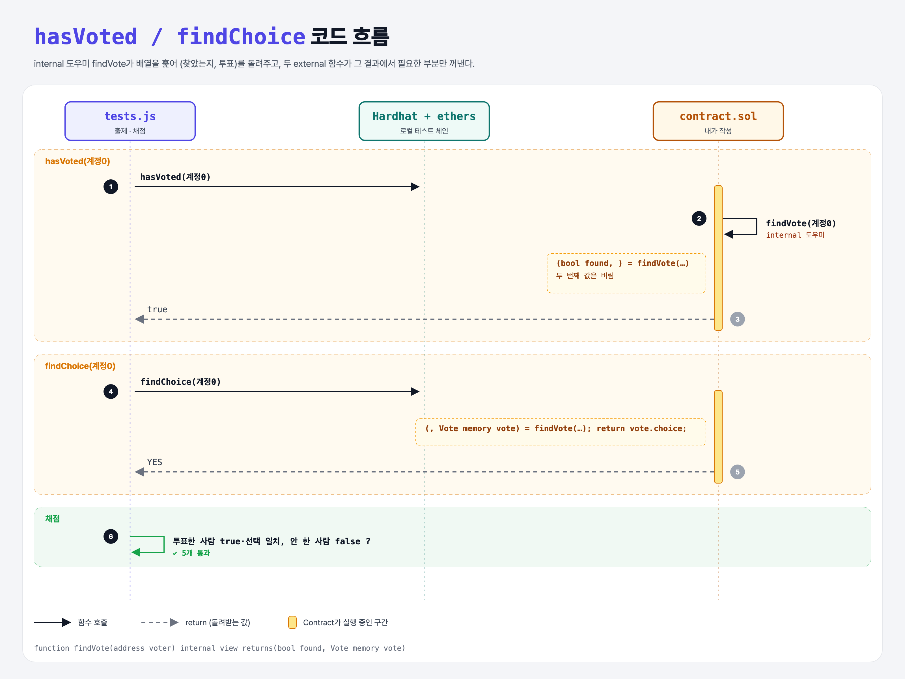

# Choice Lookup (Structs 4단계)

## 문제

1. external view `hasVoted(address)`: 그 주소가 투표했는지 bool.
2. external view `findChoice(address)`: 그 주소의 선택(Choices).

## 한 줄 요약

두 함수가 공통 **internal 도우미** `findVote`(찾았는지, 투표)를 함께 쓴다.



---

## 0. 이 과제가 말하려는 것

- 같은 반복문을 두 번 쓰지 않으려고 internal 함수로 뺐다.
- 여러 값 반환 받기: `(bool found, ) = findVote(v);`처럼 **필요 없는 값은 비워 둔다** (Python의 `found, _ = find_vote(v)`).

---

## 1. 파일 구성

| 파일 | 역할 |
|------|------|
| `contract.sol` | vote-array + **findVote, hasVoted, findChoice** |
| `tests.js` | 출제 · 채점 (테스트 5개) |

---

## 2. 정답 코드

```solidity
function findVote(address voter) internal view returns(bool found, Vote memory vote) {
    for (uint i = 0; i < votes.length; i++) {
        if (votes[i].voter == voter) {
            return (true, votes[i]);
        }
    }
    // 못 찾으면 이름 붙은 반환값의 기본값 (false, 빈 Vote)
}

function hasVoted(address voter) external view returns(bool) {
    (bool found, ) = findVote(voter);
    return found;
}

function findChoice(address voter) external view returns(Choices) {
    (, Vote memory vote) = findVote(voter);
    return vote.choice;
}
```

---

## 3. 테스트 한 줄씩

```js
assert(await contract.hasVoted(accounts[0].address));
assert.equal(await contract.findChoice(accounts[0].address), CHOICES.YES);
assert(!(await contract.hasVoted(accounts[1].address)));   // 아직 투표 안 함
```

---

## 5. 실행 방법

```bash
sh tools/sol-test.sh week5/choice-lookup
```

## 로컬 실행 환경 메모

강의 사이트는 브라우저 안에서 Hardhat으로 컴파일·테스트한다. 로컬에서는 루트의 Hardhat(ethers v5)과 `hardhat.config.js`로 똑같이 돌린다. `sh tools/sol-test.sh <폴더>`가 그 폴더의 `.sol`만 컴파일하고 테스트를 실행한다. 이 과제들은 `pragma solidity 0.8.4;`라서 설정에 0.8.4 컴파일러를 추가했다.

## 기억할 것

1. 공통 로직은 internal 함수로.
2. 튜플에서 필요 없는 값은 빈칸.
