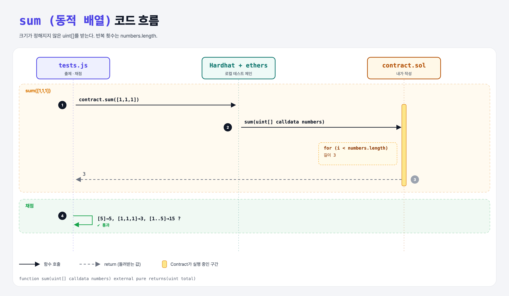

# Dynamic Sum (Arrays 2단계)

## 문제

크기가 정해지지 않은 `uint[]`를 받아 합을 돌려주기.

## 한 줄 요약

`uint[5]` → `uint[]`만 바꾸면 된다. 반복 횟수는 `numbers.length`.



---

## 0. 이 과제가 말하려는 것

동적 배열은 실행할 때 크기가 정해진다. 길이는 `.length`로 읽는다.

---

## 1. 파일 구성

| 파일 | 역할 |
|------|------|
| `contract.sol` | **sum (동적 배열)** |
| `tests.js` | 출제 · 채점 (테스트 1개) |

---

## 2. 정답 코드

```solidity
function sum(uint[] calldata numbers) external pure returns(uint total) {
    for (uint i = 0; i < numbers.length; i++) {
        total += numbers[i];
    }
}
```

---

## 3. 테스트 한 줄씩

```js
assert.equal(await contract.sum([5]), 5);
assert.equal(await contract.sum([1, 1, 1]), 3);
```

---

## 5. 실행 방법

```bash
sh tools/sol-test.sh week5/dynamic-sum
```

## 로컬 실행 환경 메모

강의 사이트는 브라우저 안에서 Hardhat으로 컴파일·테스트한다. 로컬에서는 루트의 Hardhat(ethers v5)과 `hardhat.config.js`로 똑같이 돌린다. `sh tools/sol-test.sh <폴더>`가 그 폴더의 `.sol`만 컴파일하고 테스트를 실행한다. 이 과제들은 `pragma solidity 0.8.4;`라서 설정에 0.8.4 컴파일러를 추가했다.

## 기억할 것

1. `uint[]` = 동적 크기, `.length`로 길이.
