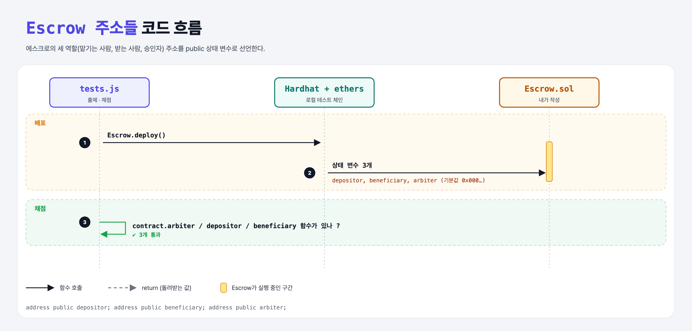

# State Variables (Build an Escrow 1단계)

## 문제

에스크로의 세 참여자 주소를 public 상태 변수로 만들기: `depositor`, `beneficiary`, `arbiter`.

## 한 줄 요약

`address public depositor; address public beneficiary; address public arbiter;`



---

## 0. 이 과제가 말하려는 것

> **에스크로 = 믿을 만한 제3자가 돈을 맡아 두었다가, 조건이 충족되면 넘겨주는 거래. 컨트랙트가 그 "맡아 두는 곳"이 된다.**

| 역할 | 하는 일 |
|------|---------|
| 🙂 **depositor** (맡기는 사람) | 돈을 맡긴다. 컨트랙트를 배포하는 사람 |
| 👨‍🔧 **beneficiary** (받는 사람) | 물건·서비스를 제공하고 돈을 받는다 |
| 👩‍⚖️ **arbiter** (승인자) | 거래가 끝났다고 판단하면 돈을 풀어 준다 |

```
[주소 3개] → constructor → payable → approve → arbiter만 → 이벤트 → JS로 배포 → JS로 승인
 escrow-addresses  escrow-constructor  escrow-funding  escrow-approve  escrow-security  escrow-event  escrow-deploy  escrow-approve-js
```

---

## 1. 파일 구성

| 파일 | 역할 |
|------|------|
| `Escrow.sol` | **이번에 완성할 컨트랙트** |
| `tests.js` | 출제 · 채점 (테스트 3개) |

---

## 2. 정답 코드

```solidity
contract Escrow {
    address public depositor;
    address public beneficiary;
    address public arbiter;
}
```

---

## 3. 테스트 한 줄씩

```js
assert(contract.arbiter, "Did not find an arbiter!");   // getter 함수가 있는지만 확인 (값은 아직 0x000…)
```

---

## 5. 실행 방법

```bash
sh tools/sol-test.sh week5/escrow-addresses
```

## 로컬 실행 환경 메모

강의 사이트는 브라우저 안에서 Hardhat으로 컴파일·테스트한다. 로컬에서는 루트의 Hardhat(ethers v5)과 `hardhat.config.js`로 똑같이 돌린다. `sh tools/sol-test.sh <폴더>`가 그 폴더의 `.sol`만 컴파일하고 테스트를 실행한다. 이 과제들은 `pragma solidity 0.8.4;`라서 설정에 0.8.4 컴파일러를 추가했다.

## 기억할 것

1. 에스크로 = 조건부로 돈을 넘겨주는 중개.
2. 세 역할: depositor, beneficiary, arbiter.
