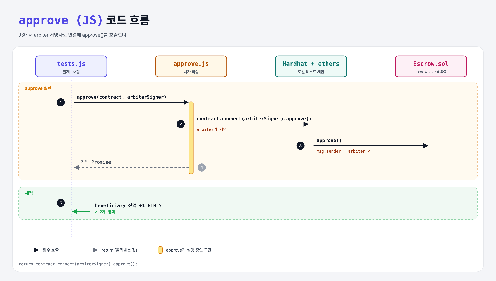

# Approve (Build an Escrow 8단계)

## 문제

`approve.js`의 `approve(contract, arbiterSigner)`: arbiter 서명자로 Escrow의 `approve`를 호출하고 거래 Promise를 돌려주기.

## 한 줄 요약

`return contract.connect(arbiterSigner).approve();`



---

## 0. 이 과제가 말하려는 것

프론트엔드의 "승인" 버튼이 하는 일이 바로 이것이다. arbiter가 서명해야 컨트랙트의 `require(msg.sender == arbiter)`를 통과한다.

```
[주소 3개] → constructor → payable → approve → arbiter만 → 이벤트 → JS로 배포 → JS로 승인
 escrow-addresses  escrow-constructor  escrow-funding  escrow-approve  escrow-security  escrow-event  escrow-deploy  escrow-approve-js
```

---

## 1. 파일 구성

| 파일 | 역할 |
|------|------|
| `approve.js` | **이번에 완성할 함수** |
| `Escrow.sol` | escrow-event 과제 그대로 |
| `tests.js` | 출제 · 채점 (테스트 2개) |

---

## 2. 정답 코드

```js
function approve(contract, arbiterSigner) {
    return contract.connect(arbiterSigner).approve();
}
```

---

## 3. 테스트 한 줄씩

```js
await approve(contract, accounts.arbiter.signer);
assert.equal(after.sub(balanceBefore).toString(), deposit.toString());
```

---

## 4. 일부러 틀려 보면

| 바꾼 것 | 결과 |
|---------|------|
| `contract.approve()` (connect 없이) | 컨트랙트가 배포자(depositor)에 연결된 채라 depositor가 서명 → `require(msg.sender == arbiter)` 실패 (직접 확인함) |

---

## 5. 실행 방법

```bash
sh tools/sol-test.sh week5/escrow-approve-js
```

## 로컬 실행 환경 메모

강의 사이트는 브라우저 안에서 Hardhat으로 컴파일·테스트한다. 로컬에서는 루트의 Hardhat(ethers v5)과 `hardhat.config.js`로 똑같이 돌린다. `sh tools/sol-test.sh <폴더>`가 그 폴더의 `.sol`만 컴파일하고 테스트를 실행한다. 이 과제들은 `pragma solidity 0.8.4;`라서 설정에 0.8.4 컴파일러를 추가했다.

## 기억할 것

1. 누가 서명하느냐 = connect(signer).
