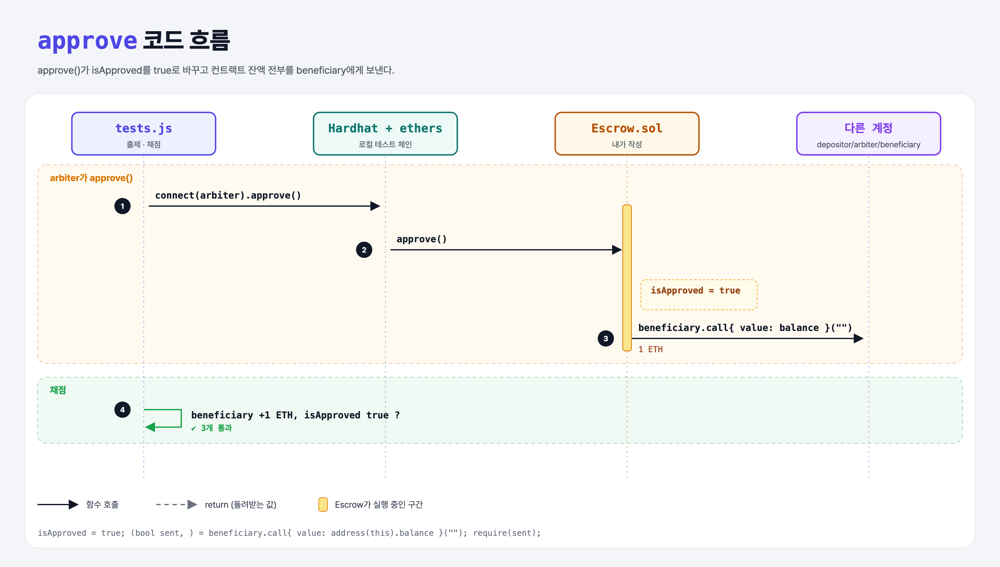

# Approval (Build an Escrow 4단계)

## 문제

1. external 함수 `approve`: 컨트랙트 잔액 전부를 beneficiary에게 보낸다.
2. public bool `isApproved`: 처음엔 false, 승인 후 true.

## 한 줄 요약

`isApproved = true;` + `beneficiary.call{ value: address(this).balance }("")`



---

## 0. 이 과제가 말하려는 것

beneficiary가 물건·서비스를 제공하면 arbiter가 승인해서 돈을 넘긴다. (이번 단계는 아직 아무나 approve를 부를 수 있다 → 다음 단계에서 막음)

```
[주소 3개] → constructor → payable → approve → arbiter만 → 이벤트 → JS로 배포 → JS로 승인
 escrow-addresses  escrow-constructor  escrow-funding  escrow-approve  escrow-security  escrow-event  escrow-deploy  escrow-approve-js
```

---

## 1. 파일 구성

| 파일 | 역할 |
|------|------|
| `Escrow.sol` | escrow-funding + **isApproved, approve** |
| `tests.js` | 출제 · 채점 (테스트 3개) |

---

## 2. 정답 코드

```solidity
bool public isApproved;

function approve() external {
    isApproved = true;
    (bool sent, ) = beneficiary.call{ value: address(this).balance }("");
    require(sent, "Failed to send ether");
}
```

상태(isApproved)를 먼저 바꾸고 외부 호출(송금)은 나중에 (Checks-Effects-Interactions).

---

## 3. 테스트 한 줄씩

```js
beforeBalance = await ethers.provider.getBalance(accounts.beneficiary.address);
await contract.connect(accounts.arbiter.signer).approve();
assert.equal(after.sub(beforeBalance).toString(), deposit.toString());   // beneficiary는 가스를 안 내서 정확히 +1 ETH
assert(await contract.isApproved());
```

---

## 5. 실행 방법

```bash
sh tools/sol-test.sh week5/escrow-approve
```

## 로컬 실행 환경 메모

강의 사이트는 브라우저 안에서 Hardhat으로 컴파일·테스트한다. 로컬에서는 루트의 Hardhat(ethers v5)과 `hardhat.config.js`로 똑같이 돌린다. `sh tools/sol-test.sh <폴더>`가 그 폴더의 `.sol`만 컴파일하고 테스트를 실행한다. 이 과제들은 `pragma solidity 0.8.4;`라서 설정에 0.8.4 컴파일러를 추가했다.

## 기억할 것

1. 송금은 `.call{ value }` + 성공 확인.
2. 상태 변경 → 외부 호출 순서.
