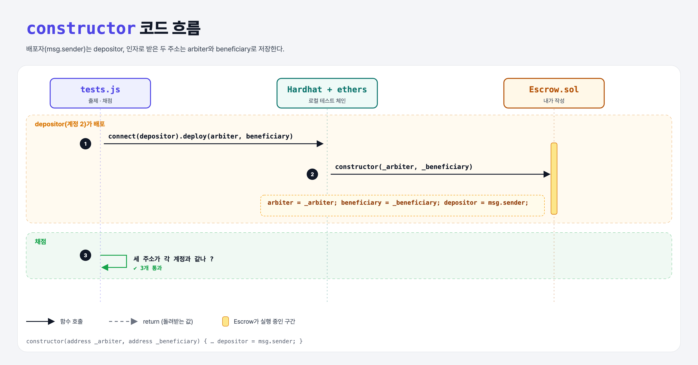

# Constructor Storage (Build an Escrow 2단계)

## 문제

arbiter 주소와 beneficiary 주소를 (이 순서로) 받는 constructor를 만들어 저장하기. depositor는 배포하는 사람(`msg.sender`).

## 한 줄 요약

`arbiter = _arbiter; beneficiary = _beneficiary; depositor = msg.sender;`



---

## 0. 이 과제가 말하려는 것

세 사람이 조건에 합의할 때마다 depositor가 새 Escrow를 배포한다. 다른 두 사람에게 주소를 받아 constructor 인자로 넣는다.

```
[주소 3개] → constructor → payable → approve → arbiter만 → 이벤트 → JS로 배포 → JS로 승인
 escrow-addresses  escrow-constructor  escrow-funding  escrow-approve  escrow-security  escrow-event  escrow-deploy  escrow-approve-js
```

---

## 1. 파일 구성

| 파일 | 역할 |
|------|------|
| `Escrow.sol` | escrow-addresses + **constructor** |
| `tests.js` | 출제 · 채점 (테스트 3개) |

---

## 2. 정답 코드

```solidity
constructor(address _arbiter, address _beneficiary) {
    arbiter = _arbiter;
    beneficiary = _beneficiary;
    depositor = msg.sender;
}
```

---

## 3. 테스트 한 줄씩

```js
const roles = ['arbiter', 'beneficiary', 'depositor'];   // 계정 0, 1, 2
contract = await Contract.connect(accounts.depositor.signer).deploy(
    accounts.arbiter.address, accounts.beneficiary.address);
assert.equal(await contract.callStatic.depositor(), accounts.depositor.address);
```

---

## 4. 일부러 틀려 보면

| 바꾼 것 | 결과 |
|---------|------|
| 인자 순서를 (beneficiary, arbiter)로 | 두 주소가 뒤바뀌어 실패 |

---

## 5. 실행 방법

```bash
sh tools/sol-test.sh week5/escrow-constructor
```

## 로컬 실행 환경 메모

강의 사이트는 브라우저 안에서 Hardhat으로 컴파일·테스트한다. 로컬에서는 루트의 Hardhat(ethers v5)과 `hardhat.config.js`로 똑같이 돌린다. `sh tools/sol-test.sh <폴더>`가 그 폴더의 `.sol`만 컴파일하고 테스트를 실행한다. 이 과제들은 `pragma solidity 0.8.4;`라서 설정에 0.8.4 컴파일러를 추가했다.

## 기억할 것

1. 배포자 = msg.sender = depositor.
