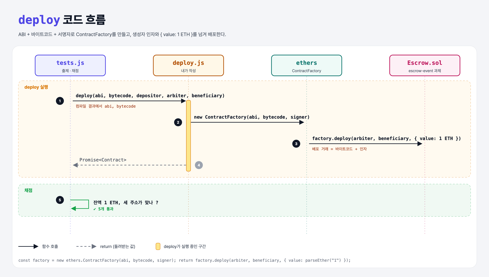

# Deploy Escrow (Build an Escrow 7단계)

## 문제

`deploy.js`의 `deploy(abi, bytecode, signer, arbiterAddress, beneficiaryAddress)`를 완성하기. ContractFactory를 만들고, 생성자 인자와 1 ETH 예치금으로 배포한 뒤 그 Promise를 돌려준다.

## 한 줄 요약

`new ethers.ContractFactory(abi, bytecode, signer).deploy(arbiter, beneficiary, { value: parseEther("1") })`



---

## 0. 이 과제가 말하려는 것

> **Hardhat의 `getContractFactory`가 내부에서 하던 일을 직접 해 본다. 컴파일 결과(ABI + 바이트코드)와 서명자만 있으면 어디서든 배포할 수 있다.**

- 배포 거래 = 바이트코드 + ABI로 인코딩한 생성자 인자. `to` 주소가 없다.
- overrides 객체(`{ value, gasLimit, nonce … }`)는 항상 마지막 인자.

```
[주소 3개] → constructor → payable → approve → arbiter만 → 이벤트 → JS로 배포 → JS로 승인
 escrow-addresses  escrow-constructor  escrow-funding  escrow-approve  escrow-security  escrow-event  escrow-deploy  escrow-approve-js
```

---

## 1. 파일 구성

| 파일 | 역할 |
|------|------|
| `deploy.js` | **이번에 완성할 함수** |
| `Escrow.sol` | escrow-event 과제 그대로 |
| `tests.js` | 출제 · 채점 (테스트 5개) |

---

## 2. 정답 코드

```js
function deploy(abi, bytecode, signer, arbiterAddress, beneficiaryAddress) {
    const factory = new ethers.ContractFactory(abi, bytecode, signer);
    return factory.deploy(arbiterAddress, beneficiaryAddress, {
        value: ethers.utils.parseEther("1"),
    });
}
```

---

## 3. 테스트 한 줄씩

```js
// 강의 원본: ./artifacts/contracts/Escrow.sol/Escrow.json 파일을 직접 읽음
const { abi, bytecode } = await hre.artifacts.readArtifact("Escrow");   // 로컬: 같은 내용을 Hardhat API로 읽음
contract = await deploy(abi, bytecode, accounts.depositor.signer, arbiter, beneficiary);
```

---

## 5. 실행 방법

```bash
sh tools/sol-test.sh week5/escrow-deploy
```

## 로컬 실행 환경 메모

강의 사이트는 브라우저 안에서 Hardhat으로 컴파일·테스트한다. 로컬에서는 루트의 Hardhat(ethers v5)과 `hardhat.config.js`로 똑같이 돌린다. `sh tools/sol-test.sh <폴더>`가 그 폴더의 `.sol`만 컴파일하고 테스트를 실행한다. 이 과제들은 `pragma solidity 0.8.4;`라서 설정에 0.8.4 컴파일러를 추가했다.

로컬은 컴파일 결과를 `.hardhat/artifacts/…`에 두기 때문에, 테스트가 아티팩트 파일 경로를 직접 읽는 대신 `hre.artifacts.readArtifact`로 같은 ABI·바이트코드를 읽도록 바꿨다.

## 기억할 것

1. 배포 = ContractFactory(abi, bytecode, signer).deploy(인자…, overrides).
