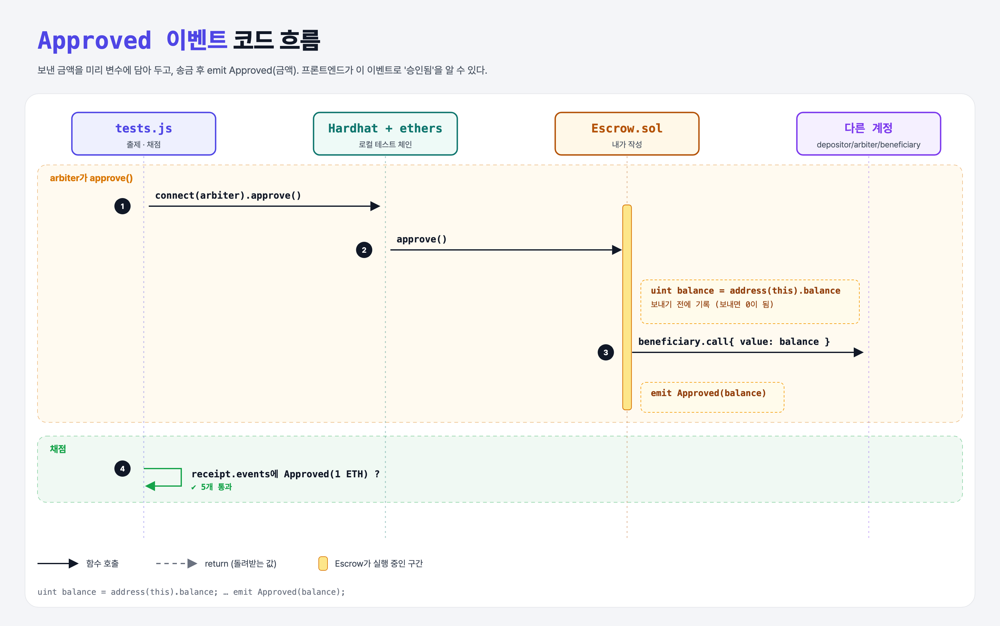

# Events (Build an Escrow 6단계)

## 문제

beneficiary에게 보낸 금액(uint 하나)을 담는 이벤트 `Approved`를 만들고, `approve` 안에서 emit하기.

## 한 줄 요약

보내기 **전에** 잔액을 변수에 담아 두고, 송금 후 `emit Approved(balance)`.



---

## 0. 이 과제가 말하려는 것

프론트엔드는 이벤트를 구독해서 "승인됨"을 화면에 보여 줄 수 있다.

```
[주소 3개] → constructor → payable → approve → arbiter만 → 이벤트 → JS로 배포 → JS로 승인
 escrow-addresses  escrow-constructor  escrow-funding  escrow-approve  escrow-security  escrow-event  escrow-deploy  escrow-approve-js
```

---

## 1. 파일 구성

| 파일 | 역할 |
|------|------|
| `Escrow.sol` | escrow-security + **Approved 이벤트** |
| `tests.js` | 출제 · 채점 (테스트 5개) |

---

## 2. 정답 코드

```solidity
event Approved(uint balance);

function approve() external {
    require(msg.sender == arbiter, "Only the arbiter can approve");
    uint balance = address(this).balance;
    isApproved = true;
    (bool sent, ) = beneficiary.call{ value: balance }("");
    require(sent, "Failed to send ether");
    emit Approved(balance);
}
```

---

## 3. 테스트 한 줄씩

```js
let tx = await contract.connect(accounts.arbiter.signer).approve();
receipt = await tx.wait();
const event = receipt.events.find(x => x.event === "Approved");
assert.equal(event.args[0].toString(), deposit.toString(), "...");
```

---

## 4. 일부러 틀려 보면

| 바꾼 것 | 결과 |
|---------|------|
| 송금 후 `emit Approved(address(this).balance)` | 이미 보내서 잔액이 0 → 이벤트 금액 테스트 실패 |

---

## 5. 실행 방법

```bash
sh tools/sol-test.sh week5/escrow-event
```

## 로컬 실행 환경 메모

강의 사이트는 브라우저 안에서 Hardhat으로 컴파일·테스트한다. 로컬에서는 루트의 Hardhat(ethers v5)과 `hardhat.config.js`로 똑같이 돌린다. `sh tools/sol-test.sh <폴더>`가 그 폴더의 `.sol`만 컴파일하고 테스트를 실행한다. 이 과제들은 `pragma solidity 0.8.4;`라서 설정에 0.8.4 컴파일러를 추가했다.

## 기억할 것

1. 보내고 나면 잔액이 바뀐다 → 필요한 값은 먼저 저장.
