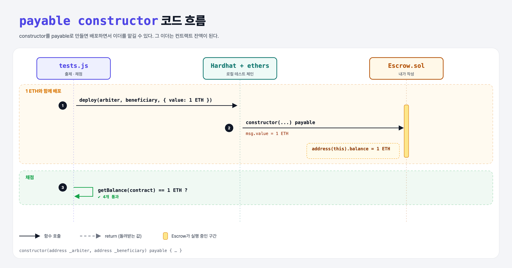

# Funding (Build an Escrow 3단계)

## 문제

constructor를 **payable**로 바꿔서 배포할 때 이더를 맡길 수 있게 하기.

## 한 줄 요약

`constructor(...) payable` — 배포 거래에 실린 이더가 그대로 컨트랙트 잔액이 된다.



---

## 0. 이 과제가 말하려는 것

depositor가 이더를 맡기면, arbiter가 승인한 뒤 beneficiary에게 넘어간다.

```
[주소 3개] → constructor → payable → approve → arbiter만 → 이벤트 → JS로 배포 → JS로 승인
 escrow-addresses  escrow-constructor  escrow-funding  escrow-approve  escrow-security  escrow-event  escrow-deploy  escrow-approve-js
```

---

## 1. 파일 구성

| 파일 | 역할 |
|------|------|
| `Escrow.sol` | escrow-constructor + **payable** |
| `tests.js` | 출제 · 채점 (테스트 4개) |

---

## 2. 정답 코드

```solidity
constructor(address _arbiter, address _beneficiary) payable {
    arbiter = _arbiter;
    beneficiary = _beneficiary;
    depositor = msg.sender;
}
```

---

## 3. 테스트 한 줄씩

```js
contract = await Contract.connect(depositor).deploy(arbiter, beneficiary, { value: deposit });   // 1 ETH
assert.equal((await ethers.provider.getBalance(contract.address)).toString(), deposit.toString());
```

---

## 4. 일부러 틀려 보면

| 바꾼 것 | 결과 |
|---------|------|
| payable 없음 | 이더를 실은 배포가 revert → 준비 단계에서 에러 |

---

## 5. 실행 방법

```bash
sh tools/sol-test.sh week5/escrow-funding
```

## 로컬 실행 환경 메모

강의 사이트는 브라우저 안에서 Hardhat으로 컴파일·테스트한다. 로컬에서는 루트의 Hardhat(ethers v5)과 `hardhat.config.js`로 똑같이 돌린다. `sh tools/sol-test.sh <폴더>`가 그 폴더의 `.sol`만 컴파일하고 테스트를 실행한다. 이 과제들은 `pragma solidity 0.8.4;`라서 설정에 0.8.4 컴파일러를 추가했다.

## 기억할 것

1. constructor도 payable이 될 수 있다.
