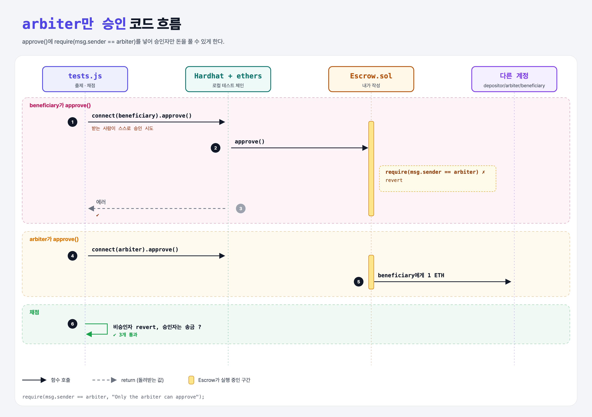

# Lock it Down (Build an Escrow 5단계)

## 문제

arbiter가 아닌 사람이 `approve`를 부르면 revert하기.

## 한 줄 요약

`require(msg.sender == arbiter, "...");`



---

## 0. 이 과제가 말하려는 것

돈을 풀어 줄 권한은 arbiter에게만 있다. 이게 없으면 beneficiary가 일을 하기도 전에 스스로 돈을 가져갈 수 있다.

```
[주소 3개] → constructor → payable → approve → arbiter만 → 이벤트 → JS로 배포 → JS로 승인
 escrow-addresses  escrow-constructor  escrow-funding  escrow-approve  escrow-security  escrow-event  escrow-deploy  escrow-approve-js
```

---

## 1. 파일 구성

| 파일 | 역할 |
|------|------|
| `Escrow.sol` | escrow-approve + **권한 확인** |
| `tests.js` | 출제 · 채점 (테스트 3개) |

---

## 2. 정답 코드

```solidity
function approve() external {
    require(msg.sender == arbiter, "Only the arbiter can approve");
    isApproved = true;
    (bool sent, ) = beneficiary.call{ value: address(this).balance }("");
    require(sent, "Failed to send ether");
}
```

---

## 3. 테스트 한 줄씩

```js
await contract.connect(accounts.beneficiary.signer).approve();   // 에러가 나야 통과
await contract.connect(accounts.arbiter.signer).approve();       // 성공 → beneficiary +1 ETH
```

---

## 5. 실행 방법

```bash
sh tools/sol-test.sh week5/escrow-security
```

## 로컬 실행 환경 메모

강의 사이트는 브라우저 안에서 Hardhat으로 컴파일·테스트한다. 로컬에서는 루트의 Hardhat(ethers v5)과 `hardhat.config.js`로 똑같이 돌린다. `sh tools/sol-test.sh <폴더>`가 그 폴더의 `.sol`만 컴파일하고 테스트를 실행한다. 이 과제들은 `pragma solidity 0.8.4;`라서 설정에 0.8.4 컴파일러를 추가했다.

화면에서 잘려 보이지 않은 assert 메시지 끝부분은 짐작으로 채웠다 (채점 결과와 무관).

## 기억할 것

1. 권한 확인은 함수 맨 앞에서 require.
