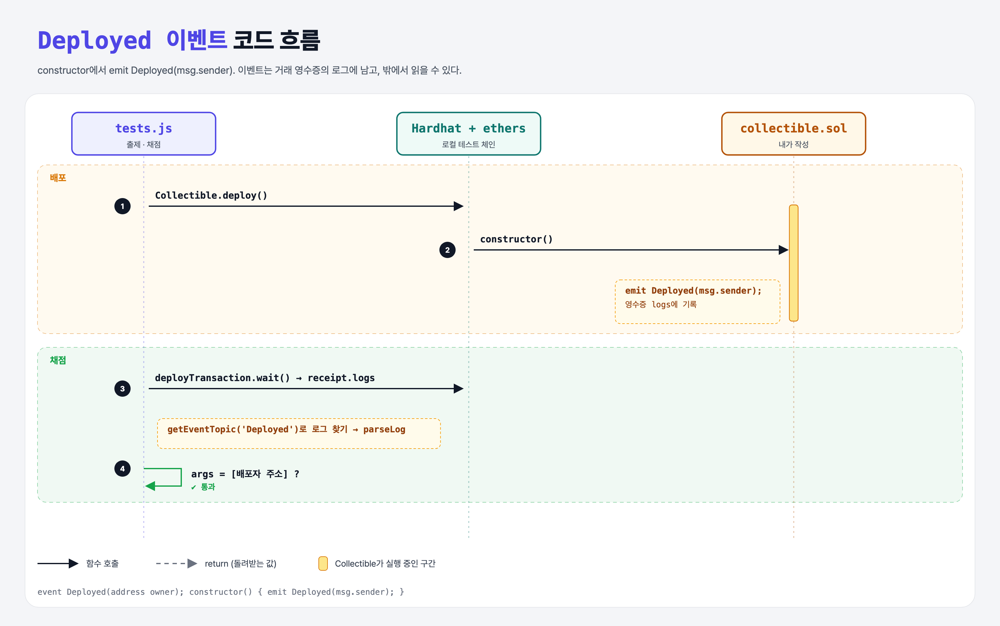

# Deployed (Events 1단계)

## 문제

1. 주소 하나를 받는 이벤트 `Deployed`를 만든다.
2. constructor에서 배포자 주소로 `Deployed`를 emit한다.

## 한 줄 요약

`event Deployed(address owner);` 선언 + `emit Deployed(msg.sender);`



---

## 0. 이 과제가 말하려는 것

> **이벤트는 거래 영수증에 남는 로그다. 컨트랙트는 못 읽지만, 밖(프론트엔드·인덱서)에서 싸게 기록을 읽을 수 있다.**

```
[Deployed] → Transfer → ForSale → Purchase → indexed
 ★ 이 단계   event-transfer  event-for-sale  event-purchase  event-indexed
```

- 이벤트 이름은 UpperCamelCase, 함수 이름은 lowerCamelCase가 관례.
- 저장소(상태 변수)보다 훨씬 싸서, "무슨 일이 있었는지" 알리는 데 쓴다.

---

## 1. 파일 구성

| 파일 | 역할 |
|------|------|
| `collectible.sol` | **이번에 완성할 컨트랙트** |
| `tests.js` | 출제 · 채점 (테스트 1개) |

---

## 2. 정답 코드

```solidity
contract Collectible {
    event Deployed(address owner);

    constructor() {
        emit Deployed(msg.sender);
    }
}
```

---

## 3. 테스트 한 줄씩

```js
const receipt = await collectible.deployTransaction.wait();       // 배포 거래의 영수증
const topic = collectible.interface.getEventTopic('Deployed');    // keccak256("Deployed(address)")
const log = receipt.logs.find(x => x.topics.indexOf(topic) >= 0); // 그 이벤트의 로그 찾기
deployedEvent = collectible.interface.parseLog(log);              // ABI로 해석
assert.equal(deployedEvent.args[0], owner);
```

- 로그의 첫 topic은 이벤트 시그니처의 해시다 (함수 선택자와 비슷한 원리, 단 32바이트 전체).

---

## 5. 실행 방법

```bash
sh tools/sol-test.sh week5/event-deployed
```

## 로컬 실행 환경 메모

강의 사이트는 브라우저 안에서 Hardhat으로 컴파일·테스트한다. 로컬에서는 루트에 설치한 Hardhat(ethers v5)과 `hardhat.config.js`로 똑같이 돌린다. `sh tools/sol-test.sh <폴더>`가 그 폴더의 `.sol`만 컴파일하고 테스트를 실행한다.

## 기억할 것

1. `event 이름(타입)` 선언 + `emit 이름(값)`.
2. 이벤트 = 영수증의 로그, 밖에서 읽는다.
