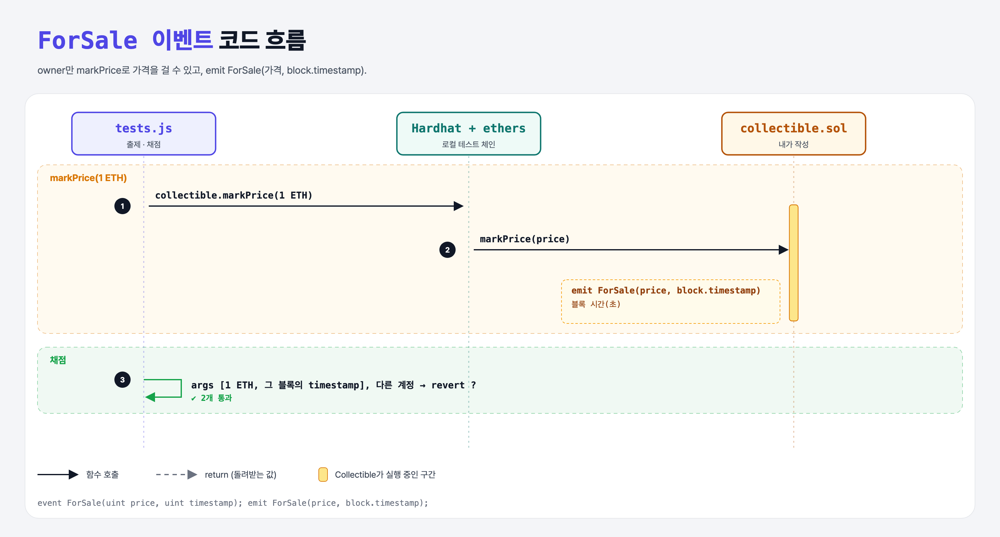

# Mark the Price (Events 3단계)

## 문제

1. uint 두 개(가격, 현재 블록 시간)를 받는 이벤트 `ForSale`을 만든다.
2. external 함수 `markPrice(uint price)`: `ForSale(price, block.timestamp)`를 emit한다.
3. 🔒 현재 주인이 아니면 revert.

## 한 줄 요약

`emit ForSale(price, block.timestamp);` — `block.timestamp`는 지금 블록의 시간(초).



---

## 0. 이 과제가 말하려는 것

- `block.timestamp`, `block.number`, `msg.sender`, `msg.value` 같은 **전역 변수**는 어디서든 쓸 수 있다.
- 블록 시간은 검증자가 어느 정도 조정할 수 있어서, 몇 초 단위의 정확도가 필요한 곳에는 쓰지 않는다.

---

## 1. 파일 구성

| 파일 | 역할 |
|------|------|
| `collectible.sol` | event-transfer + **ForSale, markPrice** |
| `tests.js` | 출제 · 채점 (테스트 2개) |

---

## 2. 정답 코드

```solidity
event ForSale(uint price, uint timestamp);

function markPrice(uint price) external {
    require(msg.sender == owner, "Only the owner can mark the price");
    emit ForSale(price, block.timestamp);
}
```

(다음 단계 purchase를 위해 event-purchase에서는 가격을 상태 변수에도 저장한다.)

---

## 3. 테스트 한 줄씩

```js
response = await collectible.markPrice(oneEther);
let block = await ethers.provider.getBlock(response.blockNumber);   // 그 거래가 들어간 블록
assert.equal(deployedEvent.args[1].toNumber(), block.timestamp);
```

---

## 5. 실행 방법

```bash
sh tools/sol-test.sh week5/event-for-sale
```

## 로컬 실행 환경 메모

강의 사이트는 브라우저 안에서 Hardhat으로 컴파일·테스트한다. 로컬에서는 루트에 설치한 Hardhat(ethers v5)과 `hardhat.config.js`로 똑같이 돌린다. `sh tools/sol-test.sh <폴더>`가 그 폴더의 `.sol`만 컴파일하고 테스트를 실행한다.

강의 테스트의 `await expect(...).to.be.reverted`는 Hardhat 전용 chai 플러그인이 필요하다. 로컬에는 그 플러그인이 없어서 **같은 검사를 try/catch로 바꿨다** (거래가 실패해야 통과). 화면에서 잘려 보이지 않은 assert 메시지 끝부분은 짐작으로 채웠다 (채점 결과와 무관).

## 기억할 것

1. `block.timestamp` = 블록 시간(초).
