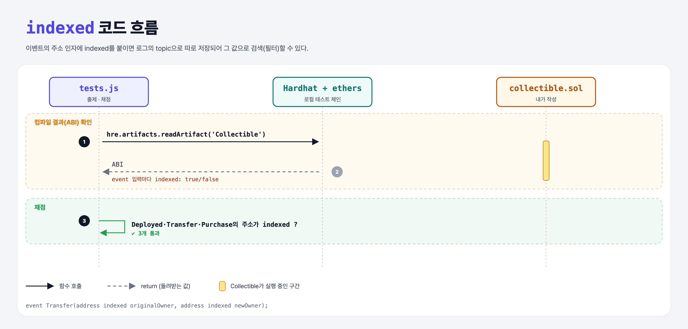

# Indexed (Events 5단계)

## 문제

이벤트들의 **주소** 인자에 모두 `indexed`를 붙이기.

## 한 줄 요약

`event Transfer(address indexed originalOwner, address indexed newOwner);`



---

## 0. 이 과제가 말하려는 것

> **indexed 인자는 로그의 topic으로 따로 저장되어, "이 주소가 관련된 Transfer만" 같은 필터 검색이 가능해진다.**

| | indexed | indexed 아님 |
|---|---|---|
| 저장 위치 | topics (최대 3개) | data |
| 값으로 검색 | ✔ | ✘ |

ethers에서: `contract.filters.Transfer(null, myAddress)` → 나에게 온 Transfer만.

---

## 1. 파일 구성

| 파일 | 역할 |
|------|------|
| `collectible.sol` | event-purchase에 **indexed 추가** |
| `tests.js` | 출제 · 채점 (테스트 3개) |

---

## 2. 정답 코드

```solidity
event Deployed(address indexed owner);
event Transfer(address indexed originalOwner, address indexed newOwner);
event ForSale(uint price, uint timestamp);
event Purchase(uint amount, address indexed buyer);
```

---

## 3. 테스트 한 줄씩

```js
artifacts = await hre.artifacts.readArtifact("Collectible");     // 컴파일 결과 (ABI 포함)
const transferEvent = artifacts.abi.find(x => x.name === "Transfer");
assert(transferEvent.inputs[0].indexed);                         // ABI에 indexed: true로 표시됨
```

- 이 테스트는 컨트랙트를 배포하지 않고 **ABI만** 확인한다.

---

## 5. 실행 방법

```bash
sh tools/sol-test.sh week5/event-indexed
```

## 로컬 실행 환경 메모

강의 사이트는 브라우저 안에서 Hardhat으로 컴파일·테스트한다. 로컬에서는 루트에 설치한 Hardhat(ethers v5)과 `hardhat.config.js`로 똑같이 돌린다. `sh tools/sol-test.sh <폴더>`가 그 폴더의 `.sol`만 컴파일하고 테스트를 실행한다.

화면에서 잘려 보이지 않은 assert 메시지 끝부분은 짐작으로 채웠다 (채점 결과와 무관).

## 기억할 것

1. indexed = 검색 가능한 이벤트 인자 (최대 3개).
