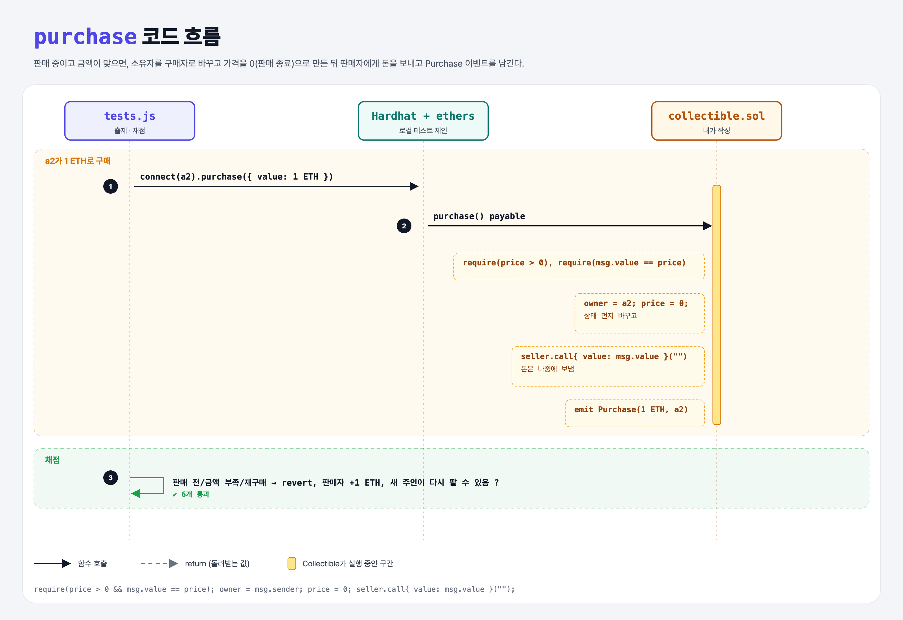

# Make a Purchase (Events 4단계)

## 문제

1. 이벤트 `Purchase(uint 금액, address 구매자)`를 만든다.
2. external **payable** 함수 `purchase`: 요청 가격으로 수집품을 산다.
   - `msg.value`를 판매자에게 보낸다.
   - 소유권을 구매자에게 넘긴다.
   - 판매 중이 아님으로 표시한다.
   - `Purchase`를 emit한다.
3. 🔒 금액이 가격과 다르거나, 판매 중이 아니면 revert.

## 한 줄 요약

가격을 상태 변수로 저장해 두고(0 = 판매 안 함), 구매 시 **상태를 먼저 바꾼 뒤** 판매자에게 이더를 보낸다.



---

## 0. 이 과제가 말하려는 것

> **돈을 보내는 외부 호출은 맨 마지막에.** 상태를 바꾸기 전에 외부로 이더를 보내면, 받는 쪽 컨트랙트가 되돌아와 다시 purchase를 부르는 **재진입(reentrancy) 공격**에 취약해질 수 있다.

순서: **검사(Checks) → 상태 변경(Effects) → 외부 호출(Interactions)**. 이 패턴을 CEI라고 부른다.

---

## 1. 파일 구성

| 파일 | 역할 |
|------|------|
| `collectible.sol` | event-for-sale + **price, Purchase, purchase** |
| `tests.js` | 출제 · 채점 (테스트 6개) |

---

## 2. 정답 코드

```solidity
uint price;   // 0이면 판매 중이 아님

function markPrice(uint _price) external {
    require(msg.sender == owner, "Only the owner can mark the price");
    price = _price;
    emit ForSale(_price, block.timestamp);
}

function purchase() external payable {
    require(price > 0, "Not for sale");                 // Checks
    require(msg.value == price, "Wrong amount");

    address seller = owner;                             // Effects
    owner = msg.sender;
    price = 0;

    (bool success, ) = seller.call{ value: msg.value }("");   // Interactions
    require(success, "Payment failed");

    emit Purchase(msg.value, msg.sender);
}
```

---

## 3. 테스트 한 줄씩

```js
// 판매 전 구매 → revert / 0.5 ETH로 구매 → revert
response = await collectible.connect(signer_a2).purchase({ value: oneEther });
purchaseEvent = receipt.events.find(x => x.event === "Purchase");   // ethers가 해석해 둔 이벤트 목록
assert.equal(balanceAfter.sub(initialBalance).toString(), parseEther("1").toString());   // 판매자 +1 ETH
// 같은 가격으로 a3가 또 구매 → price가 0이라 revert
// a2(새 주인)가 다시 가격을 걸면 a3가 살 수 있음
```

---

## 4. 일부러 틀려 보면

| 바꾼 것 | 결과 |
|---------|------|
| `price = 0` 빼먹음 | 판매 후에도 계속 살 수 있음 → 재구매 차단 테스트 실패 |
| `msg.value >= price` | 더 비싸게는 살 수 있지만 문제 조건(같아야 함)과 다름 |

---

## 5. 실행 방법

```bash
sh tools/sol-test.sh week5/event-purchase
```

## 로컬 실행 환경 메모

강의 사이트는 브라우저 안에서 Hardhat으로 컴파일·테스트한다. 로컬에서는 루트에 설치한 Hardhat(ethers v5)과 `hardhat.config.js`로 똑같이 돌린다. `sh tools/sol-test.sh <폴더>`가 그 폴더의 `.sol`만 컴파일하고 테스트를 실행한다.

강의 테스트의 `await expect(...).to.be.reverted`는 Hardhat 전용 chai 플러그인이 필요하다. 로컬에는 그 플러그인이 없어서 **같은 검사를 try/catch로 바꿨다** (거래가 실패해야 통과). 화면에서 잘려 보이지 않은 assert 메시지 끝부분은 짐작으로 채웠다 (채점 결과와 무관).

## 기억할 것

1. Checks → Effects → Interactions.
2. 가격 0 = 판매 안 함 표시.
