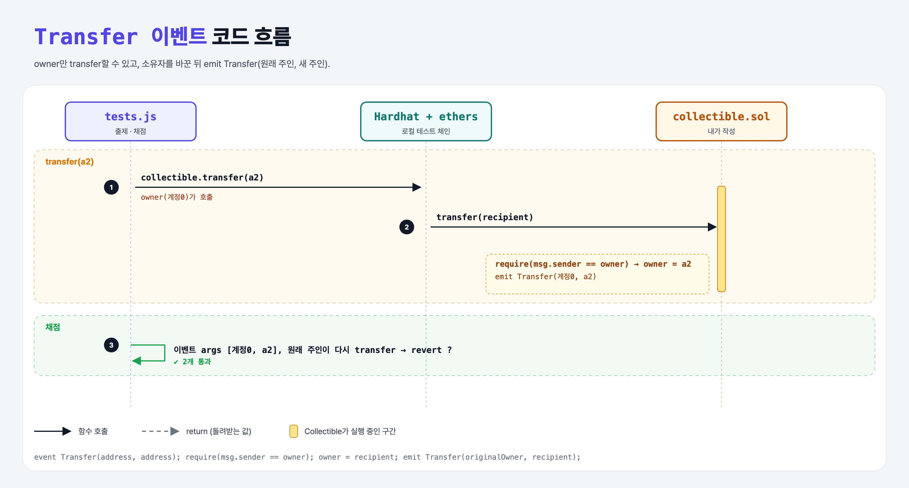

# Transfer (Events 2단계)

## 문제

1. 주소 두 개(원래 주인, 새 주인)를 받는 이벤트 `Transfer`를 만든다.
2. external 함수 `transfer(recipient)`: 소유권을 넘기고 `Transfer(원래 주인, 새 주인)`을 emit한다.
3. 현재 주인이 아니면 revert. (constructor에서 배포자를 주인으로 저장)

## 한 줄 요약

owner를 상태 변수로 저장 → `require(msg.sender == owner)` → 바꾸고 → emit.



---

## 0. 이 과제가 말하려는 것

- 이벤트 인자 이름은 생략해도 되지만, 적어 두면 ABI에 이름이 들어가서 `event.args.newOwner`처럼 읽을 수 있다.
- 새 주인을 저장하기 **전에** 원래 주인을 지역 변수에 담아 둬야 이벤트에 넣을 수 있다.

---

## 1. 파일 구성

| 파일 | 역할 |
|------|------|
| `collectible.sol` | event-deployed + **owner, Transfer, transfer** |
| `tests.js` | 출제 · 채점 (테스트 2개) |

---

## 2. 정답 코드

```solidity
address owner;

event Deployed(address owner);
event Transfer(address originalOwner, address newOwner);

constructor() {
    owner = msg.sender;
    emit Deployed(msg.sender);
}

function transfer(address recipient) external {
    require(msg.sender == owner, "Only the owner can transfer");
    address originalOwner = owner;
    owner = recipient;
    emit Transfer(originalOwner, recipient);
}
```

---

## 3. 테스트 한 줄씩

```js
response = await collectible.transfer(a2);
// Transfer 로그를 찾아 parseLog
assert.equal(deployedEvent.args[0], owner);
assert.equal(deployedEvent.args[1], a2);
// 원래 주인이 다시 transfer → 이제 주인이 아니라서 revert
```

---

## 4. 일부러 틀려 보면

| 바꾼 것 | 결과 |
|---------|------|
| `owner = recipient;` 다음에 `emit Transfer(owner, recipient)` | 원래 주인 자리에 새 주인이 들어감 → 첫 번째 값 검사 실패 |

---

## 5. 실행 방법

```bash
sh tools/sol-test.sh week5/event-transfer
```

## 로컬 실행 환경 메모

강의 사이트는 브라우저 안에서 Hardhat으로 컴파일·테스트한다. 로컬에서는 루트에 설치한 Hardhat(ethers v5)과 `hardhat.config.js`로 똑같이 돌린다. `sh tools/sol-test.sh <폴더>`가 그 폴더의 `.sol`만 컴파일하고 테스트를 실행한다.

강의 테스트의 `await expect(...).to.be.reverted`는 Hardhat 전용 chai 플러그인이 필요하다. 로컬에는 그 플러그인이 없어서 **같은 검사를 try/catch로 바꿨다** (거래가 실패해야 통과). 화면에서 잘려 보이지 않은 assert 메시지 끝부분은 짐작으로 채웠다 (채점 결과와 무관).

## 기억할 것

1. 바꾸기 전 값은 지역 변수에 보관.
2. 권한 확인 → 상태 변경 → 이벤트.
