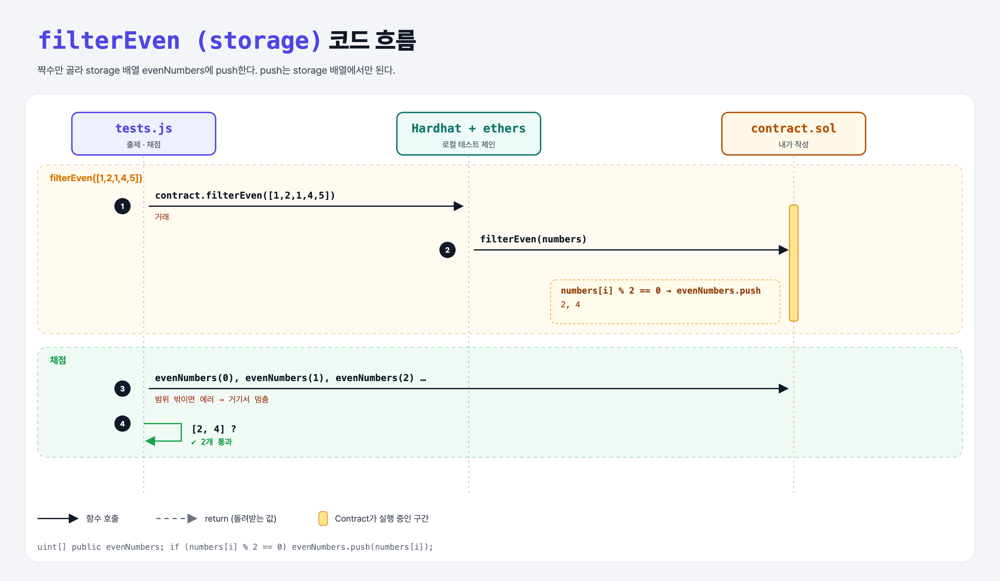

# Filter Even (Arrays 3단계)

## 문제

1. public 동적 배열 상태 변수 `evenNumbers`를 만든다.
2. external 함수 `filterEven(uint[])`: 짝수만 골라 `evenNumbers`에 push한다.

## 한 줄 요약

`if (numbers[i] % 2 == 0) evenNumbers.push(numbers[i]);`



---

## 0. 이 과제가 말하려는 것

storage 배열에는 `push`(끝에 추가)와 `pop`(끝에서 제거)이 있다. Python 리스트의 `append`, `pop`과 같다.

---

## 1. 파일 구성

| 파일 | 역할 |
|------|------|
| `contract.sol` | **evenNumbers, filterEven** |
| `tests.js` | 출제 · 채점 (테스트 2개) |

---

## 2. 정답 코드

```solidity
uint[] public evenNumbers;

function filterEven(uint[] calldata numbers) external {
    for (uint i = 0; i < numbers.length; i++) {
        if (numbers[i] % 2 == 0) {
            evenNumbers.push(numbers[i]);
        }
    }
}
```

---

## 3. 테스트 한 줄씩

```js
await contract.filterEven([1, 2, 1, 4, 5]);
assert.sameMembers(await getArrayElements(contract.evenNumbers), [2, 4]);

// public 배열 getter는 인덱스 하나씩만 읽을 수 있어서, 범위를 벗어나 에러가 날 때까지 0, 1, 2… 를 읽는다
async function getArrayElements(getterFn) {
    let vals = [];
    try { for (i = 0; ; i++) vals.push(await getterFn(i)); } catch (ex) {}
    return vals.map(x => Number(x));
}
```

---

## 5. 실행 방법

```bash
sh tools/sol-test.sh week5/filter-even
```

## 로컬 실행 환경 메모

강의 사이트는 브라우저 안에서 Hardhat으로 컴파일·테스트한다. 로컬에서는 루트의 Hardhat(ethers v5)과 `hardhat.config.js`로 똑같이 돌린다. `sh tools/sol-test.sh <폴더>`가 그 폴더의 `.sol`만 컴파일하고 테스트를 실행한다. 이 과제들은 `pragma solidity 0.8.4;`라서 설정에 0.8.4 컴파일러를 추가했다.

## 기억할 것

1. storage 배열: push / pop.
2. public 배열 getter는 인덱스 하나씩.
