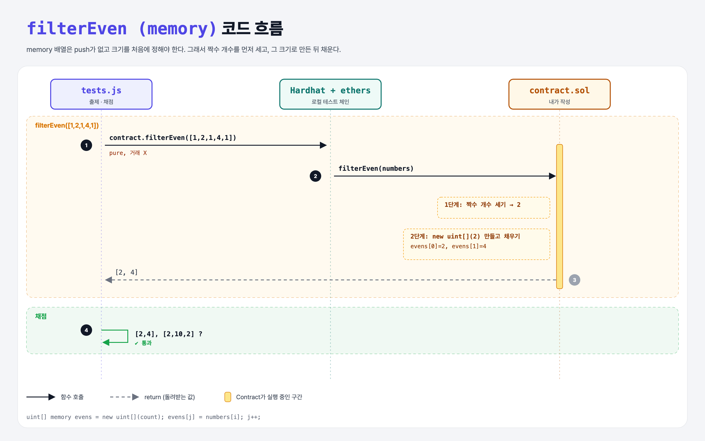

# Filter to Memory (Arrays 4단계)

## 문제

짝수만 골라 **memory**의 새 배열에 담아 돌려주는 pure, external 함수 `filterEven` 만들기.

## 한 줄 요약

memory 배열엔 push가 없다 → **짝수 개수를 먼저 세고**, `new uint[](count)`로 만든 뒤 채운다.



---

## 0. 이 과제가 말하려는 것

> **memory 배열은 만들 때 크기를 정하고, 그 뒤로는 바꿀 수 없다.**

```solidity
address[] memory addresses = new address[](x);   // x 크기로 생성
```

그래서 "개수 세기 → 만들기 → 채우기" 두 번 도는 방식이 흔하다.

---

## 1. 파일 구성

| 파일 | 역할 |
|------|------|
| `contract.sol` | **filterEven (memory)** |
| `tests.js` | 출제 · 채점 (테스트 1개) |

---

## 2. 정답 코드

```solidity
function filterEven(uint[] calldata numbers) external pure returns(uint[] memory) {
    uint count;
    for (uint i = 0; i < numbers.length; i++) {
        if (numbers[i] % 2 == 0) count++;
    }

    uint[] memory evens = new uint[](count);
    uint j;
    for (uint i = 0; i < numbers.length; i++) {
        if (numbers[i] % 2 == 0) {
            evens[j] = numbers[i];
            j++;
        }
    }
    return evens;
}
```

Python이라면 `[n for n in numbers if n % 2 == 0]` 한 줄이다.

---

## 3. 테스트 한 줄씩

```js
const result = await contract.filterEven([1, 2, 1, 4, 1]);
assert.sameMembers(result.map(x => Number(x)), [2, 4]);
```

---

## 4. 일부러 틀려 보면

| 바꾼 것 | 결과 |
|---------|------|
| `new uint[](numbers.length)`로 크게 만들기 | 남는 칸이 0으로 채워져 [2, 4, 0, 0, 0] → 실패 |
| memory 배열에 `.push` | 컴파일 에러: memory 배열엔 push가 없다 |

---

## 5. 실행 방법

```bash
sh tools/sol-test.sh week5/filter-to-memory
```

## 로컬 실행 환경 메모

강의 사이트는 브라우저 안에서 Hardhat으로 컴파일·테스트한다. 로컬에서는 루트의 Hardhat(ethers v5)과 `hardhat.config.js`로 똑같이 돌린다. `sh tools/sol-test.sh <폴더>`가 그 폴더의 `.sol`만 컴파일하고 테스트를 실행한다. 이 과제들은 `pragma solidity 0.8.4;`라서 설정에 0.8.4 컴파일러를 추가했다.

## 기억할 것

1. memory 배열 = 크기 고정, `new T[](n)`.
2. 개수 세기 → 만들기 → 채우기.
