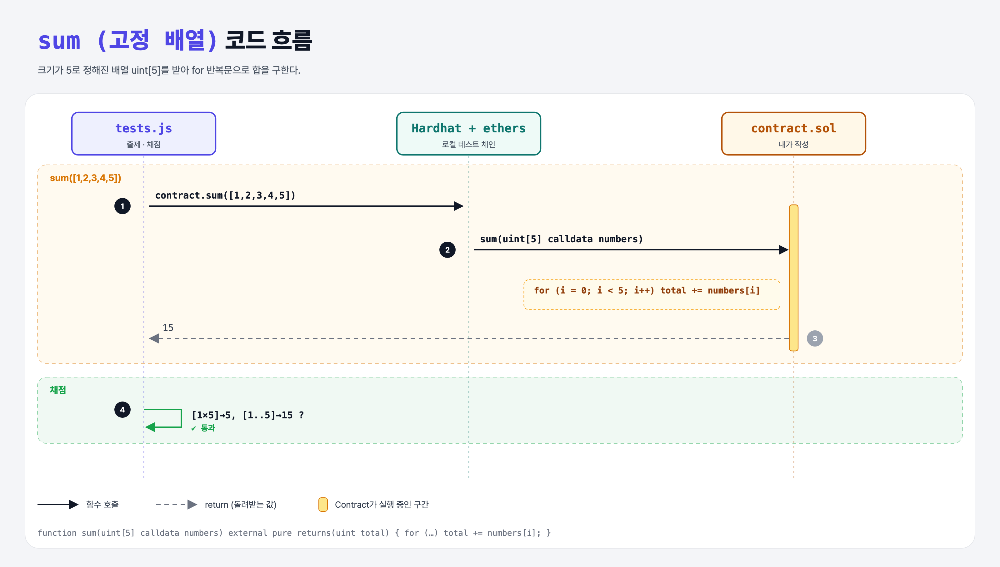

# Fixed Sum (Arrays 1단계)

## 문제

크기 5짜리 고정 배열 `uint[5]`를 받아 합을 돌려주는 pure, external 함수 `sum` 만들기.

## 한 줄 요약

`for (uint i = 0; i < numbers.length; i++) total += numbers[i];`



---

## 0. 이 과제가 말하려는 것

> **고정 크기 배열은 컴파일할 때 크기가 정해져서 늘이거나 줄일 수 없다.**

```
[고정 배열 합] → 동적 배열 합 → storage에 push → memory 배열 → StackClub → pop
 ★ 이 단계      dynamic-sum   filter-even      filter-to-memory  stack-club-add  stack-club-pop
```

| 데이터 위치 | 뜻 |
|-------------|-----|
| `storage` | 체인에 영구 저장 (상태 변수) |
| `memory` | 함수 실행 중에만 있는 임시 공간 |
| `calldata` | 외부에서 받은 인자, 읽기 전용 (가장 쌈) |

함수 안의 배열·문자열·구조체에는 이 중 하나를 꼭 적어야 한다.

---

## 1. 파일 구성

| 파일 | 역할 |
|------|------|
| `contract.sol` | **이번에 완성할 컨트랙트** |
| `tests.js` | 출제 · 채점 (테스트 1개) |

---

## 2. 정답 코드

```solidity
function sum(uint[5] calldata numbers) external pure returns(uint total) {
    for (uint i = 0; i < numbers.length; i++) {
        total += numbers[i];
    }
}
```

`for (uint i = 0; i < n; i++)`는 Python의 `for i in range(n):`. 이름 붙은 반환값 `total`은 0에서 시작한다.

---

## 3. 테스트 한 줄씩

```js
assert.equal(await contract.sum([1, 1, 1, 1, 1]), 5);
assert.equal(await contract.sum([1, 2, 3, 4, 5]), 15);
```

---

## 4. 일부러 틀려 보면

| 바꾼 것 | 결과 |
|---------|------|
| 4개짜리 배열로 호출 | ABI 인코딩 단계에서 에러 (길이가 5여야 함) |

---

## 5. 실행 방법

```bash
sh tools/sol-test.sh week5/fixed-sum
```

## 로컬 실행 환경 메모

강의 사이트는 브라우저 안에서 Hardhat으로 컴파일·테스트한다. 로컬에서는 루트의 Hardhat(ethers v5)과 `hardhat.config.js`로 똑같이 돌린다. `sh tools/sol-test.sh <폴더>`가 그 폴더의 `.sol`만 컴파일하고 테스트를 실행한다. 이 과제들은 `pragma solidity 0.8.4;`라서 설정에 0.8.4 컴파일러를 추가했다.

## 기억할 것

1. `uint[5]` = 고정 크기.
2. 배열 인자에는 데이터 위치(calldata/memory)를 적는다.
