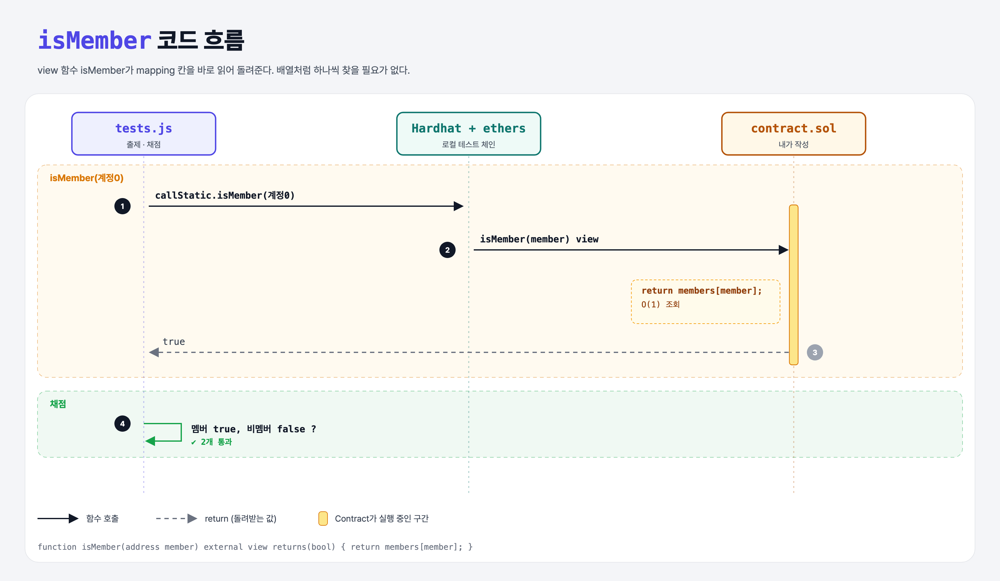

# Is Member (Mappings 2단계)

## 문제

주소를 받아 멤버인지 `bool`로 돌려주는 external **view** 함수 `isMember` 만들기.

## 한 줄 요약

`return members[member];` — mapping은 반복문 없이 한 번에 찾는다.



---

## 0. 이 과제가 말하려는 것

> **같은 일을 배열로 하면 처음부터 끝까지 돌며 찾아야 한다. 자료구조를 잘 고르면 코드도 짧고 가스도 덜 든다.**

```solidity
// mapping: 바로 찾음
return students[addr];

// 배열: 하나씩 비교
for (uint i = 0; i < students.length; i++) {
    if (students[i] == addr) return true;
}
return false;
```

mapping 값의 저장 위치는 `keccak256(키 . mapping의 슬롯 번호)`로 계산된다. 그래서 키만 알면 위치가 바로 나온다.

---

## 1. 파일 구성

| 파일 | 역할 |
|------|------|
| `contract.sol` | members-mapping + **isMember** |
| `tests.js` | 출제 · 채점 (테스트 2개) |

---

## 2. 정답 코드

```solidity
function isMember(address member) external view returns(bool) {
    return members[member];
}
```

---

## 3. 테스트 한 줄씩

```js
assert(await contract.callStatic.isMember(members[i]));
assert(!(await contract.callStatic.isMember(nonMember)));
```

---

## 5. 실행 방법

```bash
sh tools/sol-test.sh week5/is-member
```

## 로컬 실행 환경 메모

강의 사이트는 브라우저 안에서 Hardhat으로 컴파일·테스트한다. 로컬에서는 루트에 설치한 Hardhat(ethers v5)과 `hardhat.config.js`로 똑같이 돌린다. `sh tools/sol-test.sh <폴더>`가 그 폴더의 `.sol`만 컴파일하고 테스트를 실행한다.

## 기억할 것

1. mapping 조회 = O(1).
2. 읽기만 하면 `view`.
