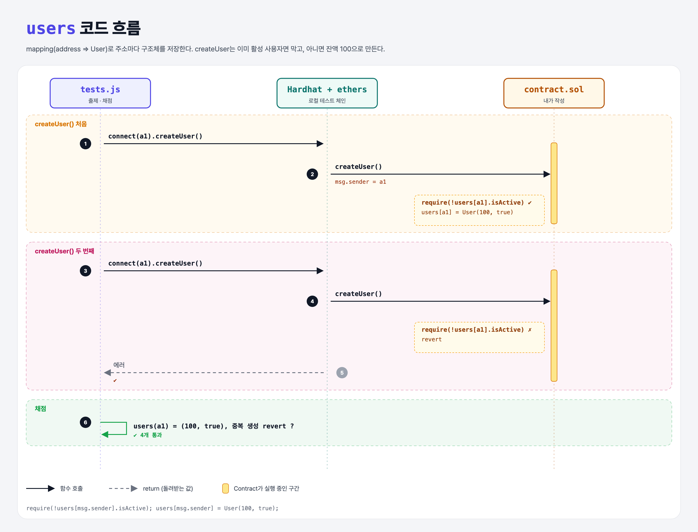

# Mapping to Struct (Mappings 4단계)

## 문제

새 토큰 만들기: 새 사용자는 100토큰을 받는다.

1. 주소를 `User` 구조체(`balance`, `isActive`)로 대응시키는 public mapping `users`를 만든다.
2. external 함수 `createUser`: `msg.sender`에게 잔액 100, `isActive = true`인 사용자를 만든다.
3. 🔒 이미 활성 사용자인 주소가 다시 부르면 revert.

## 한 줄 요약

`require(!users[msg.sender].isActive); users[msg.sender] = User(100, true);`



### 다이어그램 읽는 법

| 구간 | 일어나는 일 |
|------|-------------|
| 처음 createUser | 활성 사용자가 아니라서 통과 → User(100, true) 저장 |
| 두 번째 createUser | 이미 활성 → require 실패 → revert |
| 채점 | 잔액·활성 여부와 중복 생성 차단 확인 |

---

## 0. 이 과제가 말하려는 것

> **mapping의 값으로 구조체를 두면 주소마다 여러 정보를 묶어 저장할 수 있다.**

- `isActive` 같은 플래그를 두는 이유: mapping은 모든 키가 이미 있어서, 새로 만든 사용자인지 원래 없던 사용자인지 구분할 방법이 필요하다.

---

## 1. 파일 구성

| 파일 | 역할 |
|------|------|
| `contract.sol` | **users, createUser** |
| `tests.js` | 출제 · 채점 (테스트 4개) |

---

## 2. 정답 코드

```solidity
struct User {
    uint balance;
    bool isActive;
}

mapping(address => User) public users;

function createUser() external {
    require(!users[msg.sender].isActive, "User already exists");
    users[msg.sender] = User(100, true);
}
```

- `User(100, true)`: 필드 순서대로 값을 넣어 구조체를 만든다. `User({ balance: 100, isActive: true })`처럼 이름을 붙여도 된다.

---

## 3. 테스트 한 줄씩

```js
await contract.connect(a1).createUser();
const user = await contract.users(await a1.getAddress());   // 구조체 getter → { balance, isActive }
assert.equal(user.balance, 100);
assert(user.isActive, "...");
// 같은 주소로 다시 createUser → 에러가 나야 통과
```

---

## 4. 일부러 틀려 보면

| 바꾼 것 | 결과 |
|---------|------|
| require 없이 덮어쓰기 | 두 번 불러도 성공 → 중복 생성 테스트 실패 (잔액을 100으로 되돌리는 꼼수도 가능) |

---

## 5. 실행 방법

```bash
sh tools/sol-test.sh week5/mapping-structs
```

## 로컬 실행 환경 메모

강의 사이트는 브라우저 안에서 Hardhat으로 컴파일·테스트한다. 로컬에서는 루트에 설치한 Hardhat(ethers v5)과 `hardhat.config.js`로 똑같이 돌린다. `sh tools/sol-test.sh <폴더>`가 그 폴더의 `.sol`만 컴파일하고 테스트를 실행한다.

화면에서 잘려 보이지 않은 assert 메시지 끝부분은 짐작으로 채웠다 (채점 결과와 무관).

## 기억할 것

1. mapping 값으로 struct를 저장할 수 있다.
2. "존재하는지"는 플래그(isActive)로 표시한다.
